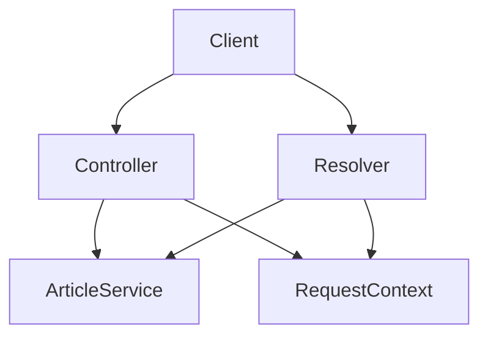
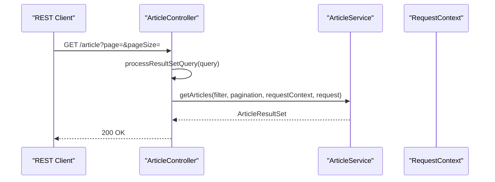
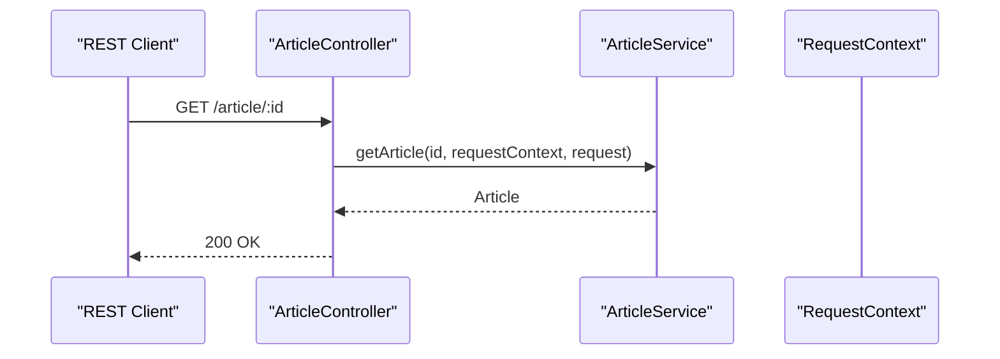
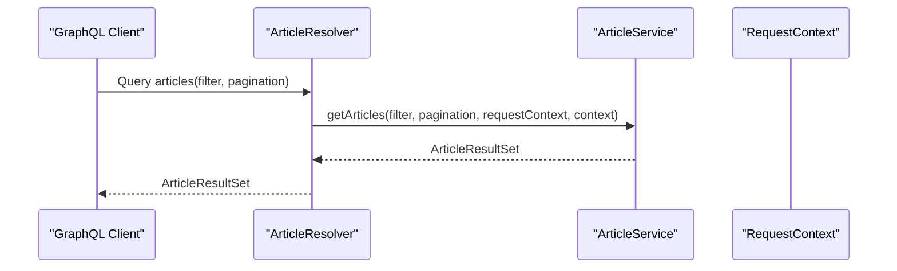
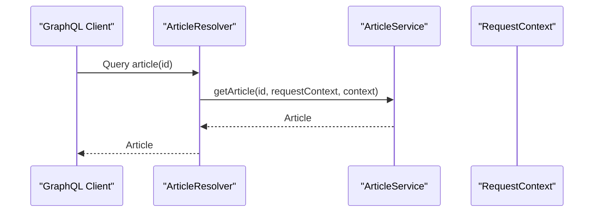

# Article Feature Documentation

## Overview
The `article` feature provides read-only access to catalog articles (including buying guides and similar content). It exposes:

- A paginated list of articles (`articles`)
- A single article by id (`article`)

Both GraphQL and REST controller operations delegate to the abstract `ArticleService`.

## Controller operations
REST endpoints exposed by `ArticleController`:

- `GET /article?page={page}&pageSize={pageSize}&type={type}`
  - Query parameters: `page`, `pageSize`, `type` (from `ArticleResultSetQuery`)
  - Response: `ArticleResultSet` (includes pagination metadata and `results`)
- `GET /article/:id`
  - Path parameter: `id` (string)
  - Response: `Article`

## GraphQL API
GraphQL queries exposed by `ArticleResolver`:

- `articles(filter: ArticleFilter, pagination: PaginationInput): ArticleResultSet`
  - Arguments: `filter` (optional type filter), `pagination` (page/pageSize)
  - Returns: `ArticleResultSet`
- `article(id: String): Article`
  - Arguments: `id`
  - Returns: `Article`

## Schema (model)
GraphQL schema types exposed by this feature:

- `Article`
  - `id: string`
  - `identifier: string`
  - `name: string`
  - `summary: string`
  - `description: string`
  - `image: Image`
  - `readTime: Int`
  - `colorTheme: string`
  - `type: string`
  - `createdAt: string`
  - `products: Product[]`
- `ArticleResultSet`
  - `results: Article[]`
  - pagination metadata (inherited from `ResultSet`)
- `ArticleResultSetQuery`
  - `page: number`
  - `pageSize: number`
  - `type: string`

## Service interface contract (plugin contract)
Abstract service: `ArticleService`

Methods plugins must implement:

- `getArticles(filter: ArticleFilter, pagination: PaginationInput, requestContext: RequestContext, context?: any): Promise<ArticleResultSet>`
  - Semantics: return a paginated list of articles
- `getArticle(id: string, requestContext: RequestContext, context?: any): Promise<Article>`
  - Semantics: return a single article by its `id`

Errors:

- `getArticlesFailed`
- `getArticleFailed`

Request context:
Both methods receive `RequestContext` extracted from the incoming request/context. Implementations may use it for tenant/consumer resolution and other cross-cutting concerns.

## Diagrams

### Component diagram

### Sequence diagrams

#### Sequence: GET list (`articles`) - REST

#### Sequence: GET by id (`article`) - REST

#### Sequence: Query list (`articles`) - GraphQL

#### Sequence: Query by id (`article`) - GraphQL

