# Shopping list feature (Staging)

## Overview

The **shopping-list** feature models a cart-like container for commerce **without** quote/cart concerns: **no line or container pricing, taxes, promotions, coupons, payments, or shipping**. It supports named lists, line quantities, optional product identifiers, variant option keys, and notes. List reads can filter and paginate lines using the same `ItemFilterInput` / `PaginationInput` / `SortByInput` pattern as cart.

The **Commercetools** plugin provides an in-memory `CommercetoolsShoppingListServiceImpl` stub (per consumer and anonymous token purse key) until a real Shopping Lists API integration is added.

## Controller operations

Base path: `/shopping-list`

| Method | Path | Description |
|--------|------|-------------|
| GET | `/:id` | Get a list; use `current` or omit path semantics per deployment for the session list |
| PUT | `/:id` | Update list metadata (`name`, `identifier`) |
| DELETE | `/:id` | Remove the list from the stub store |
| POST | `/:id/item` | Add one line |
| POST | `/:id/items` | Add multiple lines (body `items`) |
| PUT | `/:id/item/:itemId` | Update one line |
| PUT | `/:id/items` | Update multiple lines |
| DELETE | `/:id/item/:itemId` | Delete one line |
| PUT | `/:id/items/@delete` | Delete multiple lines (body `items`) |

Query parameters for read/update line operations follow `QuoteResultSetQuery` (filter, pagination, sort) like cart.

## GraphQL API

| Operation | Type | Arguments | Returns |
|-----------|------|-----------|---------|
| `shoppingList` | Query | `id`, `filter`, `pagination`, `sortBy` | `ShoppingList` |
| `shoppingListUpdate` | Mutation | `id`, `updateShoppingList`, `filter`, `pagination`, `sortBy` | `ShoppingList` |
| `shoppingListDelete` | Mutation | `id` | `ShoppingList` |
| `shoppingListItemsAdd` | Mutation | `id`, `items`, `filter`, `pagination`, `sortBy` | `ShoppingList` |
| `shoppingListItemsUpdate` | Mutation | `id`, `items`, `filter`, `pagination`, `sortBy` | `ShoppingList` |
| `shoppingListItemsDelete` | Mutation | `id`, `items`, `filter`, `pagination`, `sortBy` | `ShoppingList` |

## Schema (model)

- **`ShoppingList`**: `id`, `identifier`, `name`, `itemQuantity`, `status`, `createdOn`, `updatedOn`, `items` (`ShoppingListItemResultSet`). No pricing, coupons, payments, or shipping fields.
- **`ShoppingListItem`**: `id`, `identifier`, `quantity`, `notes`, `status`, `options` (`ItemOption[]`). No `Money`, adjustments, or taxes.
- **Inputs**: `ShoppingListUpdateInput`, `ShoppingListItemAddInput`, `ShoppingListItemUpdateInput`, `ShoppingListItemDeleteInput`, plus batch body types for REST.

## Service interface contract (plugin contract)

Abstract **`ShoppingListService`** (`shopping-list.service.ts`):

- `getShoppingList(id, filter, pagination, sortBy, requestContext, context?)`
- `deleteShoppingList(id, requestContext, context?)`
- `updateShoppingList(id, updateInput, filter, pagination, sortBy, requestContext, context?)`
- `addShoppingListItems(id, items, filter, pagination, sortBy, requestContext, context?)`
- `updateShoppingListItems(id, items, filter, pagination, sortBy, requestContext, context?)`
- `deleteShoppingListItems(id, items, filter, pagination, sortBy, requestContext, context?)`

Errors: **`ShoppingListErrors`** — `getShoppingListFailed`, `deleteShoppingListFailed`, `updateShoppingListFailed`, `missingShoppingListId`, `addShoppingListItemsFailed`, `updateShoppingListItemsFailed`, `deleteShoppingListItemsFailed` (plus shared commerce errors).

## Diagrams

### Component diagram

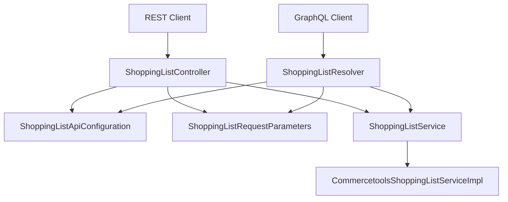

### Sequence: GET shopping list (REST)

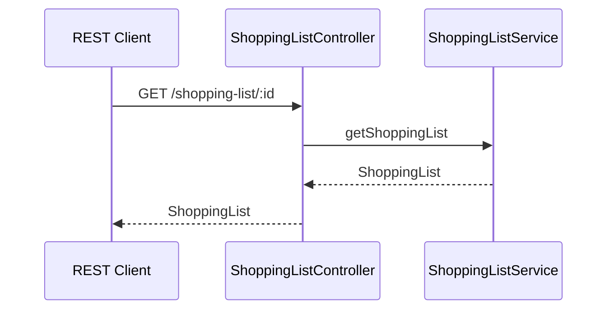

### Sequence: PUT shopping list update (REST)

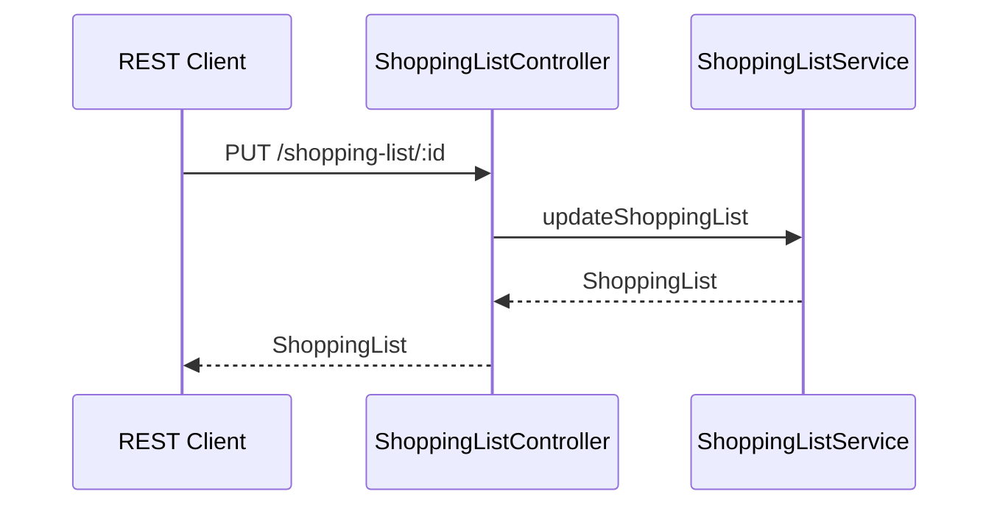

### Sequence: DELETE shopping list (REST)

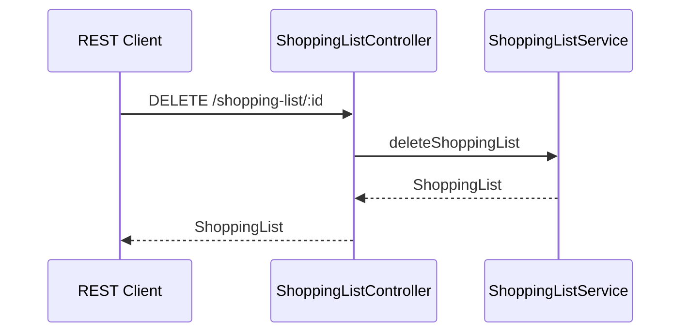

### Sequence: POST shopping list item (REST)

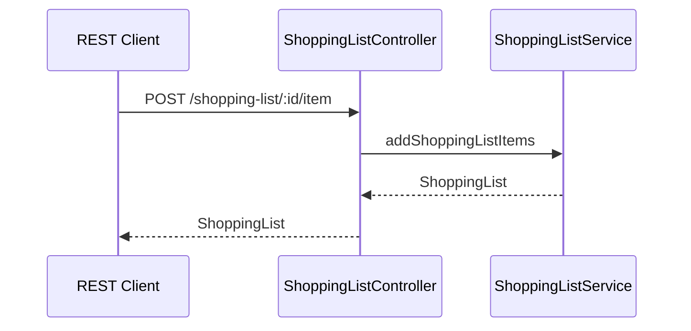

### Sequence: POST shopping list items (REST)

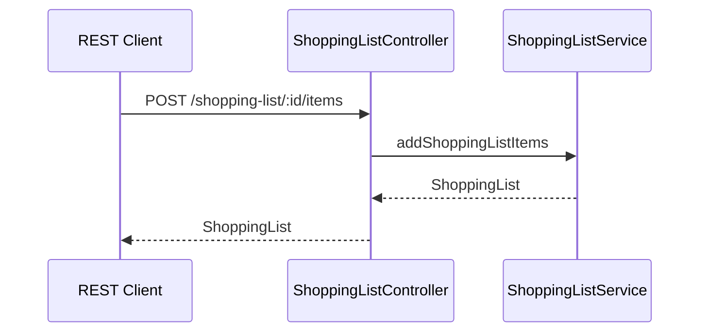

### Sequence: PUT shopping list item (REST)

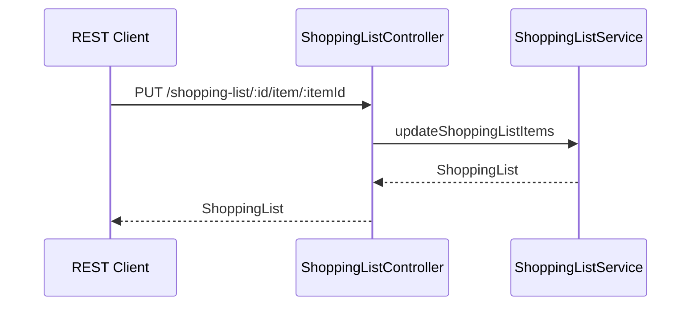

### Sequence: PUT shopping list items (REST)

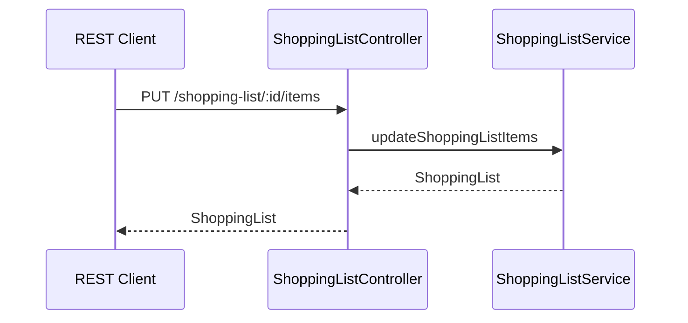

### Sequence: DELETE shopping list item (REST)

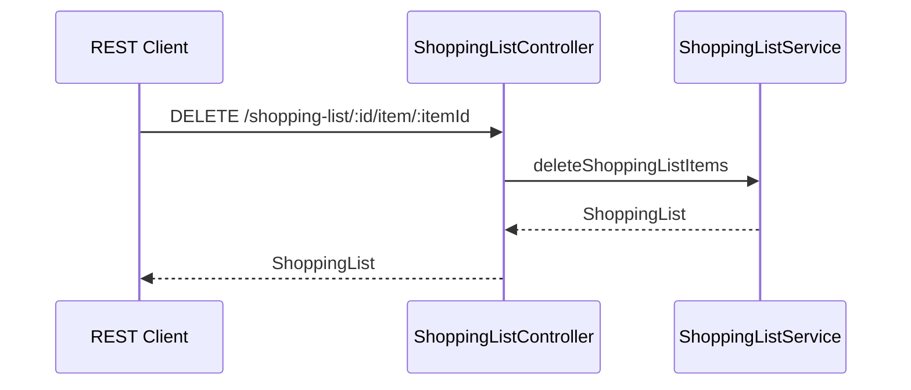

### Sequence: PUT shopping list items delete (REST)

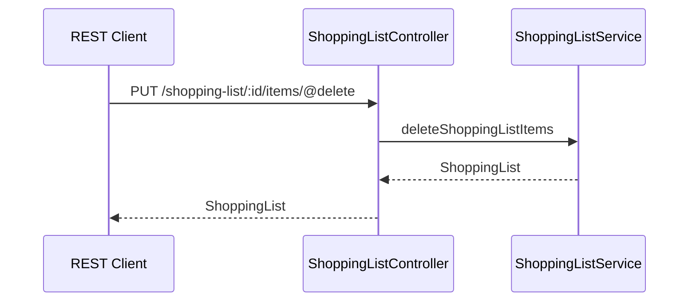

### Sequence: Query shoppingList (GraphQL)

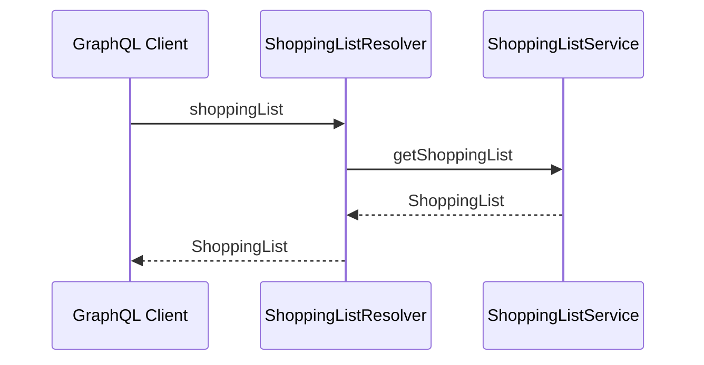

### Sequence: Mutation shoppingListUpdate (GraphQL)

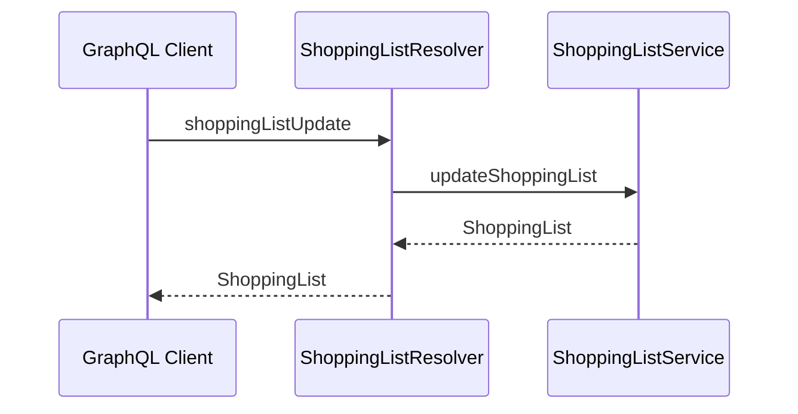

### Sequence: Mutation shoppingListDelete (GraphQL)

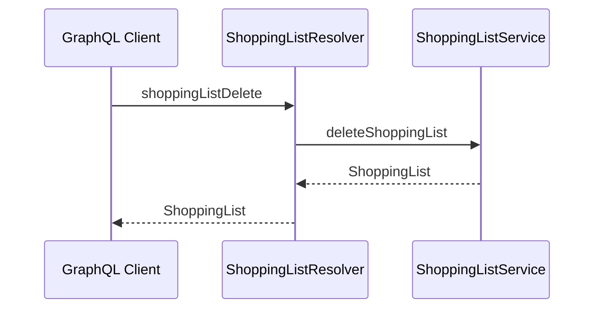

### Sequence: Mutation shoppingListItemsAdd (GraphQL)

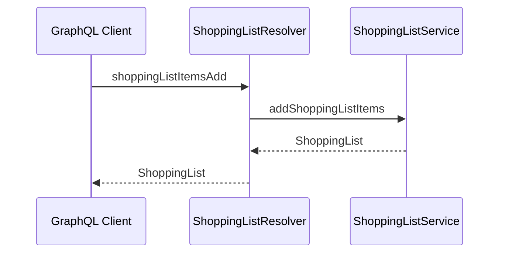

### Sequence: Mutation shoppingListItemsUpdate (GraphQL)

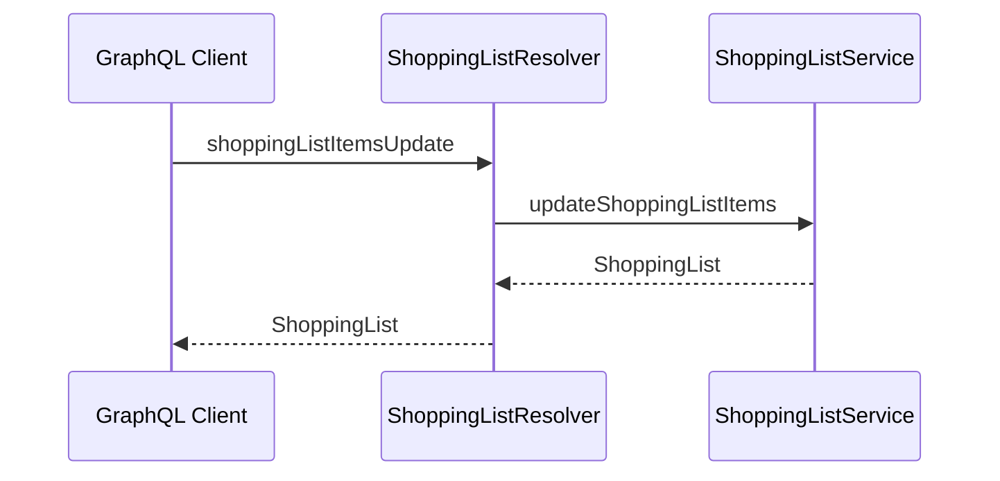

### Sequence: Mutation shoppingListItemsDelete (GraphQL)

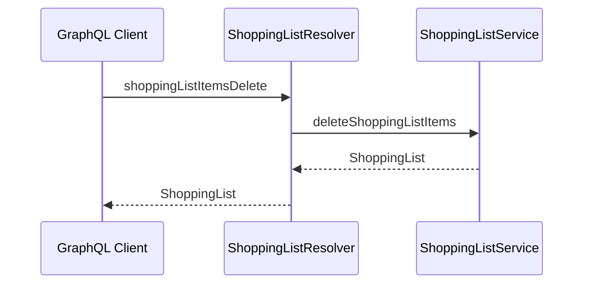
