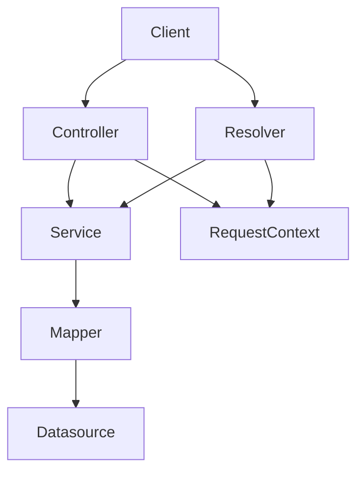
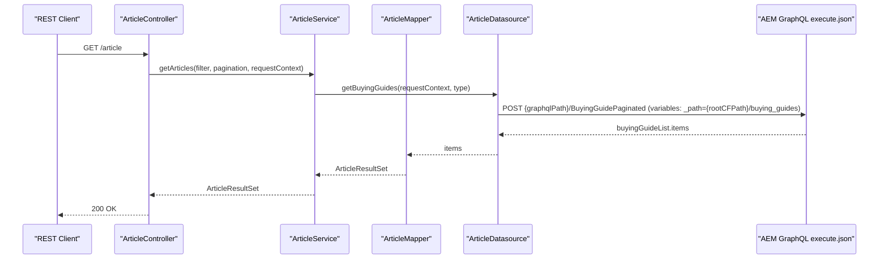
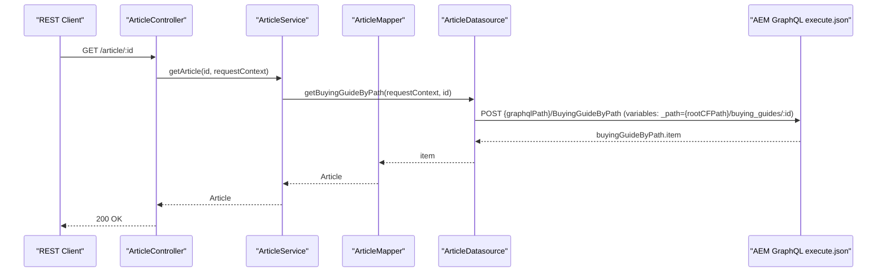
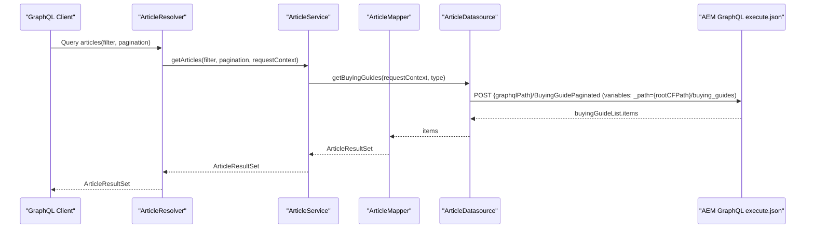
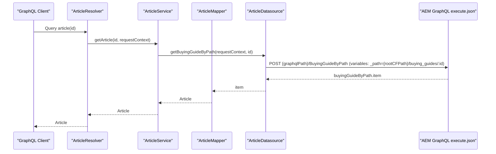

# adobe-aem article plugin feature

## Overview
This plugin feature implements the `article` feature contract using an AEM-backed REST datasource.
It fetches articles (including buying guides) via AEM GraphQL persisted operations exposed at `/graphql/execute.json/*`.

## Backend integration
- Services integrated: AEM GraphQL `execute.json` endpoint (invoked over HTTP REST calls)
- Supported operations:
  - `BuyingGuidePaginated` (list)
  - `BuyingGuideByPath` (single by content fragment path)
- Configuration:
  - Uses the existing `adobe-aem` plugin consumer configuration for:
    - authentication (Basic Auth / IMS token)
    - GraphQL base path (`graphqlPath_Commons`)
- Authentication / headers:
  - Authorization header is injected by the shared `adobe-aem` base datasource.

## Diagrams

### Component diagram

### Sequence diagrams

#### Sequence: GET list (`articles`) - REST

#### Sequence: GET by id (`article`) - REST

#### Sequence: Query list (`articles`) - GraphQL

#### Sequence: Query by id (`article`) - GraphQL

