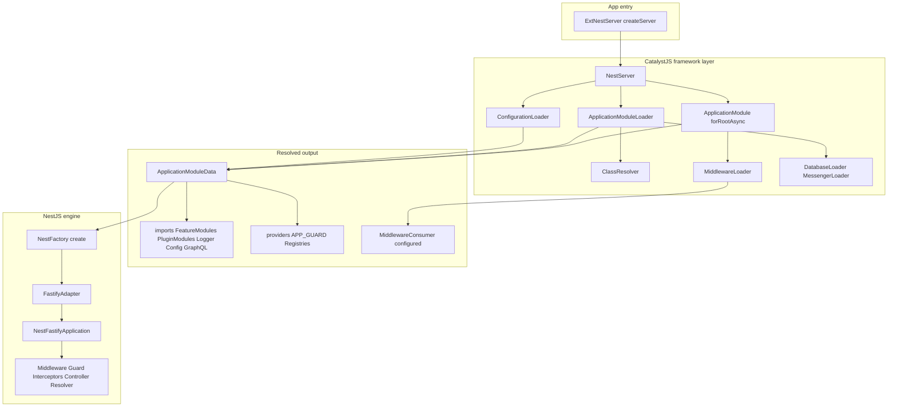
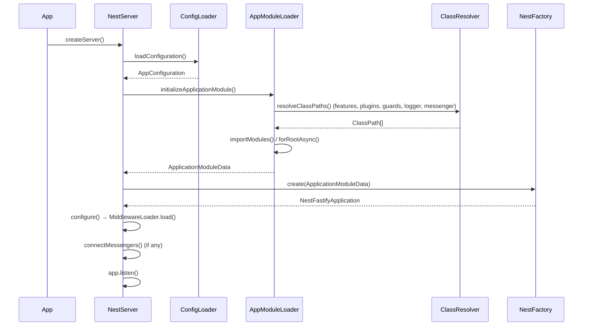
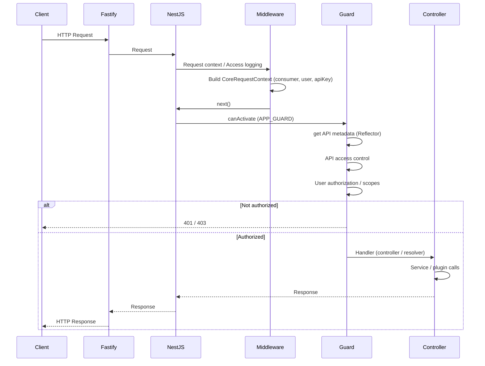

# CatalystJS Architecture

This document provides an in-depth technical overview of the CatalystJS framework architecture, its integration with the NestJS engine, and the typical request lifecycle.

## High-Level Overview

CatalystJS is a **framework layer** built on top of NestJS. It does not replace NestJS; instead, it provides:

- **Configuration-driven module loading**: Features, plugins, databases, and middleware are discovered and registered based on YAML configuration and the [class loading hierarchy](class-loading-hierarchy.md).
- **Dynamic module assembly**: At startup, the framework resolves class paths, dynamically imports modules, and assembles a single NestJS application module that is passed to `NestFactory.create()`.
- **Convention over configuration**: File naming, directory structure, and decorators drive API metadata, authorization, and OpenAPI/Swagger generation.
- **Multi-app support**: A single codebase can host multiple applications (and optionally an admin app), each with its own configuration and resolved modules.

The result is a NestJS application: Fastify as the HTTP adapter, standard NestJS middleware pipeline, guards, interceptors, and the same request/response flow. CatalystJS is the **bootstrapping and assembly layer**; NestJS is the **runtime engine**.

---

## Framework and NestJS Engine

The following diagram shows how the CatalystJS framework layer interacts with the NestJS engine.

**Summary:**

| Layer | Responsibility |
|-------|----------------|
| **App entry** | Calls `NestServer.createServer()` (or extended `ExtNestServer`). |
| **CatalystJS** | Loads configuration, resolves feature/plugin/module class paths via `ClassResolver`, builds `ApplicationModuleData` (imports, providers, middleware config). Does **not** handle HTTP directly. |
| **Resolved output** | A single NestJS `DynamicModule`-like structure: `ApplicationModuleData` with `imports`, `providers`, and middleware registered via `NestModule.configure(consumer)`. |
| **NestJS engine** | `NestFactory.create(appModule)` creates the NestJS application (Fastify), runs the standard pipeline (middleware → guards → controllers/resolvers). |

The framework **prepares** the module graph; NestJS **runs** it.

---

## Bootstrap and Startup Flow

Startup proceeds in the following order:

1. **Entry**: `app.ts` calls `ExtNestServer.createServer()` (or `NestServer.createServer()`).
2. **Environment**: `dotenv` loads `.env` and `.env.{APP_ENV}` from the app directory.
3. **Configuration**: `ConfigurationLoader.loadConfiguration()` reads `configuration.yaml`, primes features/plugins/consumers, applies environment overrides, and produces `AppConfiguration`.
4. **Application module**: `createApplicationModule(configuration)` is invoked (often overridden to use `ExtApplicationModule.forRootAsync(...)`).
5. **ApplicationModuleLoader.initializeApplicationModule**:
   - Resolves **feature modules** from config (using `ClassResolver` and `**/features` directory).
   - Resolves **plugin modules** per feature (using `ClassResolver` and `**/plugins` directory).
   - Resolves **logger**, **messenger**, and **global guard** modules.
   - **Imports** resolved modules (dynamic `import()` of compiled `.js` files).
   - Calls each feature/plugin module’s `forRootAsync(configuration, moduleData, ...)` to get NestJS `DynamicModule`s.
   - Builds **ApplicationModuleData**: `imports` (all feature/plugin modules, ConfigModule, GraphQL, Cache, etc.), `providers` (e.g. `APP_GUARD` for each global guard, application-level registries), and references for datastores.
6. **Datastore imports**: `DatabaseLoader.load()` and `MessengerLoader.load()` add database and messenger modules to `ApplicationModuleData.imports`.
7. **ApplicationModule.forRootAsync**: Merges the loaded module data with standard imports (ConfigModule, EventEmitter, HttpModule, GraphQLModule, CacheModule) and returns the final module descriptor.
8. **NestFactory.create(appModule)**: NestJS creates the application using the provided module and Fastify adapter. If `fastifyBodyLimit` is set in configuration, it is passed to the adapter. Binary content-type parsers (`application/octet-stream`, common image and video types) are registered so those bodies are available as buffers. `@fastify/cookie` is registered and parsed cookies are copied onto the raw `IncomingMessage` so middleware can read the auth token cookie.
9. **Middleware**: When the app boots, `ApplicationModule.configure(consumer)` runs; `MiddlewareLoader.load(consumer, configService, false)` registers all configured middleware (core + feature/plugin middleware) in sequence.
10. **Messengers**: If configured, `connectMessengers()` connects microservices (e.g. Kafka, Redis) to the app.
11. **Listen**: `app.listen(port, host)` starts the HTTP server.

---

## Module Hierarchy and Loaders

### Module types

- **Application module**: Root module for one app (e.g. `ApplicationModule` / `ExtApplicationModule`). Built by `ApplicationModuleLoader` and `ApplicationModule.forRootAsync()`.
- **Feature modules**: NestJS modules representing a feature (e.g. user, notification). Each has controllers, resolvers, services, and optional plugins. Resolved by `ApplicationModuleLoader.resolveFeatureModules()` and class path `**/features/**/{featureId}.module.js`.
- **Plugin modules**: NestJS modules that provide implementations for a feature (e.g. REST client, database). Resolved per feature from config; class path includes `**/plugins` and plugin/feature IDs.
- **Foundation modules**: Logger, Messenger, global guards. Resolved by `ApplicationModuleLoader` from foundation directories and `guards`.
- **Datastore modules**: Databases and messengers. Loaded by `DatabaseLoader` and `MessengerLoader` and added to the application’s `imports`.

### Class resolution

All “where is the class?” resolution is centralized in **ClassResolver** (`core/foundation/utilities/class-resolver.utility.ts`). It searches, in sequence, directories such as `core`, `core-modules`, `src/core-staging`, `src/apps/global`, `src/apps/{appName}`. The file owned by a higher priority directory (ie `src/apps/{appName}` is higher priority than `core-modules`). This drives which feature/plugin/guard implementation is used. See [Class Loading Hierarchy](class-loading-hierarchy.md).

### Loaders

| Loader | Purpose |
|--------|--------|
| **ConfigurationLoader** | Reads `configuration.yaml`, primes features/plugins/consumers, applies env overrides. |
| **ApplicationModuleLoader** | Resolves and loads feature, plugin, logger, messenger, and global guard modules; builds `ApplicationModuleData`. |
| **MiddlewareLoader** | Registers middleware with Nest’s `MiddlewareConsumer` (core middleware + feature/plugin middleware from config). |
| **DatabaseLoader** | Loads TypeORM (or other) database modules from configuration. |
| **MessengerLoader** | Loads microservice client modules (Kafka, Redis, etc.) from configuration. |

---

## Request Lifecycle

Once the app is running, every HTTP request (REST or GraphQL) passes through the **NestJS pipeline**. CatalystJS does not replace this pipeline; it populates it (middleware, guards, controllers/resolvers).

### Typical request flow

1. **Fastify receives the request** and hands it to NestJS.
2. **Global middleware** run in the order registered by `MiddlewareLoader` (e.g. request-context middleware, then access-logging). Request-context middleware builds `RequestContext` (correlation id, consumer, user, API key, etc.) and attaches it to the request.
3. **Route matching**: NestJS matches the URL to a controller (REST) or to GraphQL.
4. **Authorization guard** (registered as `APP_GUARD`): Runs for the matched handler. It:
   - Reads `RequestContext` from the request.
   - Uses `Reflector` to get API metadata (e.g. `Api`, `ApiOperation`) from the controller/resolver class and method.
   - Performs **API access control** (if enabled and not suppressed): checks API key/consumer against configuration.
   - Performs **user authorization** (if required): e.g. `isUserAuthorized()`, then user scope check against operation/feature scope.
   - If any check fails, the guard denies the request (e.g. throws `UnauthorizedException`).
5. **Controller/Resolver**: If the guard allows, the request reaches the controller method or GraphQL resolver. Services and plugins are injected by NestJS as defined in feature/plugin modules.
6. **Response**: The handler returns; NestJS and Fastify send the response.

The following diagram summarizes this lifecycle.

### Components involved

- **RequestContextMiddleware** (or equivalent): Builds and attaches `RequestContext` (e.g. `consumer`, `user`, `apiKey`, `correlationId`).
- **AuthorizationGuard**: Global guard; implements API access control and user authorization using decorator metadata and config.
- **Controllers / Resolvers**: Registered by feature (and plugin) modules; use `@Controller` / `@Resolver` and operation decorators so the guard and Swagger can read API and operation metadata.

---

## Key Architectural Principles

1. **Single NestJS app per process**: One application module (with many nested feature/plugin modules) is created and passed to `NestFactory.create()`. No custom HTTP stack.
2. **Configuration as source of truth**: Which features and plugins are enabled, and how they are configured (consumers, middleware, operations), comes from `configuration.yaml` and environment variables.
3. **Class resolution over hardcoding**: Feature/plugin/guard implementations are discovered by path and naming conventions (ClassResolver), enabling overrides per app or global without changing core.
4. **Decorators for metadata**: REST/GraphQL APIs and authorization behavior are driven by decorators (`@Controller`, `@Resolver`, operation decorators) and optional feature-level config (e.g. `operations[].acp`).
5. **Extensibility points**: Apps extend `NestServer` and `ApplicationModule` to customize module creation, Swagger, and other bootstrap behavior; they extend guards (e.g. `AuthorizationGuard`) to customize user auth and scopes.

---

## Related Documentation

- [Class Loading Hierarchy](class-loading-hierarchy.md) — How and where classes are resolved (core, core-modules, core-staging, global, app).
- [Components](components.md) — Features, plugins, databases, and other building blocks.
- [Authorization and Access Control](authorization-and-access-control.md) — Guard behavior, configuration, and extension.
