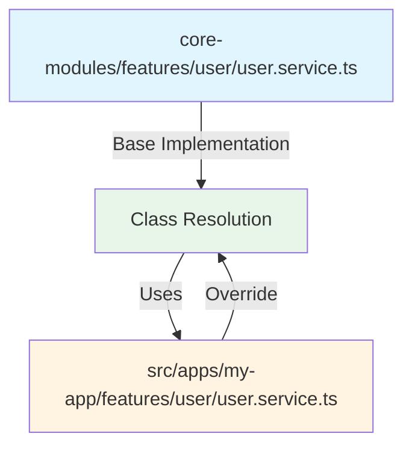
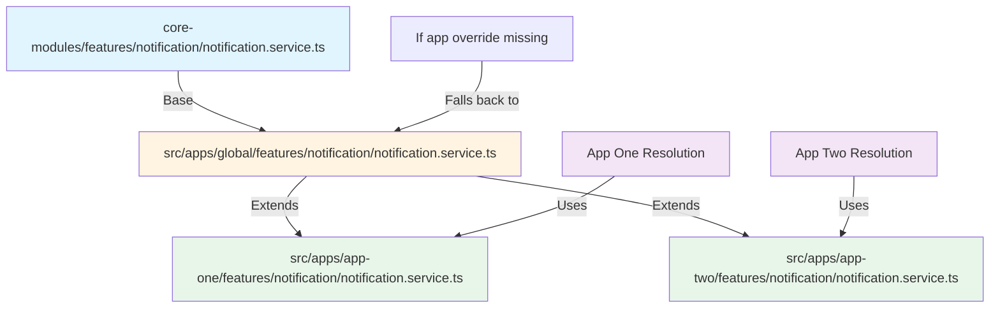

# Class Loading Hierarchy

CatalystJS uses a sophisticated class loading system that scans multiple directories in a specific order to discover and load classes. This system enables extensibility and allows applications to override or extend core functionality.

## Overview

The `ClassResolver` utility (`./core/foundation/utilities/class-resolver.utility.ts`) is responsible for discovering classes across the framework. It scans directories in a hierarchical order, allowing classes in higher-priority directories to override or extend classes from lower-priority directories.

## Directory Scanning Order

The framework scans directories in the following sequence (higher sequence numbers have higher priority):

| Sequence | Directory | Path | Description |
|----------|-----------|------|-------------|
| 0 | `core` | `core/` | Core framework classes. These are the base implementations and should not altered |
| 1 | `core-modules` | `core-modules/` | Official framework modules (features, plugins, databases, middleware, guards, etc). These can be extended but provide default implementations and should not be altered. |
| 2 | `core-staging` | `src/core-staging/` | Staging area for components being prepared for core-modules packaging. |
| 3 | `global` | `src/apps/global/` | Global application extensions and custom components shared across all apps. |
| 4 | `app` | `src/apps/{appName}/` | Application-specific overrides and extensions. |

### Resolution Priority

When multiple classes with the same relative path exist across directories, the framework uses the **first match found** according to the sequence order. This means:

- Classes in `core-modules` can extend classes from `core`
- Classes in `src/apps/{appName}` can override classes from `core-modules` or `core-staging`
- Classes in `src/apps/global` can override classes from `core-modules` but are overridden by app-specific classes

> **⚠️ Critical**: Extension files **must** maintain the same relative directory path structure as their base components. For example, if a file exists at `core-modules/features/user/user.service.ts`, an extension must be placed at `src/apps/{appName}/features/user/user.service.ts` (maintaining the `features/user/` relative path). The class resolution system matches files by their relative path structure, so mismatched paths will not be recognized as overrides.

## The `src/core-staging` Directory

The `src/core-staging` directory serves as a staging area for components that are candidates for inclusion in the `core-modules` ecosystem. This directory is designed for creating **vanilla, framework-agnostic components** that can potentially be promoted to official framework modules.

### Purpose

Use `src/core-staging` when you need to:

1. **Create net-new vanilla components**: Build new features, plugins, or other components from scratch that follow framework conventions but aren't yet part of the official `core-modules` collection.

2. **Extend existing `core-modules` components**: Add vanilla, reusable functionality to components that already exist in `core-modules` without modifying the original modules directly.

### Key Principles

- **Vanilla Implementation**: Components in `src/core-staging` should contain only framework-agnostic, reusable logic. They should not include application-specific or implementation-specific code.

- **Implementation-Specific Logic**: Any application-specific or implementation-specific logic should be placed in **app extension classes** that extend the `src/core-staging` classes. These extensions belong in `src/apps/{appName}/` or `src/apps/global/`.

- **Promotion Path**: Once a component in `src/core-staging` has been tested and proven useful, it can be reviewed to be included in the official framework ecosystem.

### Example Structure

```
src/core-staging/
  features/
    healthcare/
      pharmacy/
        pharmacy.module.ts          # Vanilla module
        pharmacy.service.ts         # Vanilla service logic
        pharmacy.controller.ts      # Vanilla controller
        pharmacy.resolver.ts         # Vanilla resolver

src/apps/my-app/
  features/
    healthcare/
      pharmacy/
        pharmacy.service.ts         # Extends src/core-staging version
                                   # Adds app-specific implementation logic
```

In this example:
- The `src/core-staging` version contains reusable, vanilla pharmacy functionality
- The `src/apps/my-app` version extends the staging version and adds application-specific implementation details
- The app-specific service will be used when resolving classes for `my-app`, but it can leverage the vanilla base implementation
- **Note**: Both files maintain the same relative path structure (`features/healthcare/pharmacy/`) - this is required for proper class resolution

### Best Practices

1. **Keep it vanilla**: Avoid hardcoding application-specific configurations, business rules, or external service integrations in `src/core-staging` components.

2. **Use extension classes**: Place implementation-specific logic in app-specific extension classes that inherit from or extend the staging components.

3. **Follow framework conventions**: Use the same file naming rules and directory structure as `core-modules` to ensure smooth promotion later.

4. **Document for promotion**: When ready for promotion, ensure components are well-documented and follow all framework standards before moving to `core-modules`.

## Class Types

Classes are categorized into three types based on where they are discovered:

- **`core`**: Classes found in the `core` directory
- **`custom`**: The first non-core class found (from core-modules, core-staging, global, or app)
- **`extension`**: Classes that extend core classes

## How Class Resolution Works

The `ClassResolver.resolveClassPaths()` method performs the following steps:

1. **Builds search paths**: Constructs paths for each directory in sequence order
2. **Searches for files**: Uses `fast-glob` to find files matching the specified pattern
3. **Maps results**: Groups files by their relative path to identify overrides
4. **Returns class paths**: Returns an array of `ClassPath` objects with resolved file locations

### Example Code

```typescript
import { ClassResolver } from './core/foundation/utilities/class-resolver.utility';

// Resolve controller classes for a feature
const classPaths = await ClassResolver.resolveClassPaths(
  '**/user*.controller.js',  // File pattern to search for
  'catalyst-tutorial', // App name
  'features',     // Optional directory name to narrow search
  logger,              // Logger instance
  false                // isTSFile: false = search in dist/, true = search in source
);

// classPaths will contain all matching controller files found across directories, and the resolved class path will be
// the determined by the above sequence definitions
```

### Parameters

- **`classFileFormat`**: File pattern to search for (e.g., `*.controller.js`, `*.service.ts`)
- **`appName`**: The application name (used to construct the app-specific path)
- **`directoryName`**: Optional directory name to narrow the search scope (e.g., `features/user`)
- **`logger`**: Logger instance for debugging
- **`isTSFile`**: If `false`, searches in `dist/` directory (compiled JS). If `true`, searches in source TypeScript files
- **`normalizedToken`**: Optional token for normalizing paths when dealing with plugin structures

## Path Matching Requirements

When creating extensions or overrides, you **must** maintain the exact same relative directory path structure as the component you're extending. The class resolution system matches files by their relative path, so mismatched paths will not be recognized as overrides.

### How Path Matching Works

The framework compares the relative path from the base directory (e.g., `core-modules/`, `src/apps/{appName}/`) to identify matching files. The relative path structure must be identical across all directories.

### Examples

**✅ Correct Path Matching:**

```
core-modules/features/user/user.service.ts
src/apps/my-app/features/user/user.service.ts    # Same relative path: features/user/
```

```
core-modules/plugins/tutorial-pet-db/features/user/tutorial-pet-db.user.service.ts
src/apps/my-app/plugins/tutorial-pet-db/features/user/tutorial-pet-db.user.service.ts    # Same relative path: plugins/tutorial-pet-db/features/user/
```

**❌ Incorrect Path Matching (will NOT work):**

```
core-modules/features/user/user.service.ts
src/apps/my-app/user/user.service.ts             # Missing 'features/' directory
```

```
core-modules/features/user/user.service.ts
src/apps/my-app/custom/user/user.service.ts      # Wrong directory structure
```

### Path Matching Rules

1. **Relative path must match exactly**: The path structure after the base directory must be identical
2. **File name can differ**: Only if using consumer-specific naming (e.g., `site-2.tutorial-pet-rest.user.service.ts`)
3. **Applies to all extension directories**: `src/apps/{appName}/`, `src/apps/global/`, and `src/core-staging/` all follow this rule
4. **Nested structures**: For nested features (e.g., `features/healthcare/pharmacy/`), maintain the full nested path

## Directory Naming Structure

### Features

Features are organized under the `features` directory:

```
features/
  {feature-id}/
    {feature-id}.module.ts
    {feature-id}.model.ts
    {feature-id}.parameters.ts
    {feature-id}.api.configuration.ts
    {feature-id}.service.ts
    {feature-id}.controller.ts
    {feature-id}.resolver.ts
    {feature-id}.error.ts
```

**Example:**
```
core-modules/features/user/
  user.module.ts
  user.model.ts
  user.service.ts
  user.controller.ts
  user.resolver.ts
```

**Extension Example** (maintaining same relative path):
```
src/apps/my-app/features/user/          # Same relative path: features/user/
  user.service.ts                        # Extends core-modules version
```

**Incorrect Extension** (path mismatch - will NOT be recognized):
```
src/apps/my-app/custom/user/            # ❌ Wrong path - missing 'features/'
  user.service.ts                        # This will NOT override the core-modules version
```

### Plugins

Plugins follow a similar structure but include plugin-specific components:

```
plugins/
  {plugin-id}/
    features/
      {feature-id}/
        {plugin-id}.{feature-id}.module.ts
        {plugin-id}.{feature-id}.datasource.ts
        {plugin-id}.{feature-id}.mapper.ts
        {plugin-id}.{feature-id}.registry.ts
        {plugin-id}.{feature-id}.service.ts
        {plugin-id}.{feature-id}.entity.ts
```

**Example:**
```
core-modules/plugins/tutorial-pet-db/features/user/
  tutorial-pet-db.user.module.ts
  tutorial-pet-db.user.datasource.ts
  tutorial-pet-db.user.mapper.ts
  tutorial-pet-db.user.service.ts
```

**Extension Example** (maintaining same relative path):
```
src/apps/my-app/plugins/tutorial-pet-db/features/user/    # Same relative path: plugins/tutorial-pet-db/features/user/
  tutorial-pet-db.user.service.ts                           # Extends core-modules version
```

### Consumer-Specific Extensions

Plugins can have consumer-specific implementations:

```
plugins/{plugin-id}/features/{feature-id}/
  {consumer-id}.{plugin-id}.{feature-id}.service.ts
```

**Example:**
```
src/apps/catalyst-tutorial/plugins/tutorial-pet-rest/features/user/
  tutorial-pet-rest.user.service.ts          # Default implementation
  site-2.tutorial-pet-rest.user.service.ts    # Consumer-specific override
```

## File Naming Rules

> **⚠️ Important**: The file name suffix format and Class Name Suffix are **required**. Since TypeScript files can contain multiple exports, the class resolution system needs to know which specific export to initialize. The file suffix pattern and class name suffix work together to identify the correct class to load.
>
> **Entities are the exception:** a single `*.entity.ts` file may export more than one class whose name ends with `Entity`. Class loading stores every matching export on `ClassPath.classObjs` (not just the first on `classObj`), and `BasePluginModule` registers all of them with TypeORM. Other component types still use the first matching export.

### Feature Components

| Component Type | File Suffix | Class Name Suffix | Description |
|----------------|-------------|-------------------|-------------|
| Module | `.module.ts` | `Module` | NestJS module definition |
| Model | `.model.ts` | `Model` | Data models and DTOs |
| Parameters | `.parameters.ts` | `Parameters` | Request parameter definitions |
| API Configuration | `.api.configuration.ts` | `ApiConfiguration` | API decorator configuration |
| Service | `.service.ts` | `Service` | Business logic implementation |
| Controller | `.controller.ts` | `Controller` | REST API endpoints |
| Resolver | `.resolver.ts` | `Resolver` | GraphQL resolvers |
| Error | `.error.ts` | `Error` | Custom error classes |
| Subscription PubSub | `.subscription.pubsub.ts` | `SubscriptionPubSub` | GraphQL subscription pub/sub |

### Plugin Components

| Component Type | File Suffix | Class Name Suffix | Description |
|----------------|-------------|-------------------|-------------|
| Module | `.module.ts` | `Module` | Plugin module definition |
| Datasource | `.datasource.ts` | `Datasource` | Data source implementations |
| Mapper | `.mapper.ts` | `Mapper` | Data transformation mappers |
| Registry | `.registry.ts` | `Registry` | Component registries |
| Service | `.service.ts` | `ServiceImpl` | Plugin service implementations |
| Entity | `.entity.ts` | `Entity` | Database entities. **All** exported `*Entity` classes in the file are registered, not just the first. |

## File Loading Order

When generating index files, components are exported in a specific order to ensure dependencies are resolved correctly:

### Feature Index Order

1. `*.module.ts`
2. `*.model.ts`
3. `*.parameters.ts`
4. `*.api.configuration.ts`
5. `*.service.ts`
6. `*.controller.ts`
7. `*.resolver.ts`
8. `*.error.ts`

### Plugin Index Order

1. `*.module.ts`
2. `*.datasource.ts`
3. `*.mapper.ts`
4. `*.registry.ts`
5. `*.service.ts`
6. `*.error.ts`
7. `schema/*.ts` (if schema subdirectory exists)
8. `types/*.ts` (if types subdirectory exists)

## Best Practices

1. **Use consistent naming**: Follow the file naming rules to ensure classes are discovered correctly
2. **Maintain path structure**: **Always** preserve the exact relative directory path when creating extensions. If extending `core-modules/features/user/user.service.ts`, place your extension at `src/apps/{appName}/features/user/user.service.ts` (not `src/apps/{appName}/user/user.service.ts`)
3. **Leverage the hierarchy**: Place overrides in app-specific directories (`src/apps/{appName}`) to extend core functionality
4. **Avoid core modifications**: Never modify classes in the `core` directory directly; use extensions instead
5. **Consumer-specific overrides**: Use consumer-specific file naming for plugin components that need different implementations per consumer
6. **Directory structure**: Maintain the expected directory structure (`features/{id}/`, `plugins/{id}/features/{id}/`) for proper discovery

## Example: Overriding a Class

### Example 1: App-Specific Override

To override a class from `core-modules` in your application:

1. **Original location**: `core-modules/features/user/user.service.ts`
2. **Override location**: `src/apps/my-app/features/user/user.service.ts`

**Important**: Notice that both files maintain the same relative path structure (`features/user/`). The extension file must mirror the directory structure of the base file for proper resolution.

The framework will discover both files, but the app-specific version will be used because `src/apps/{appName}` has a higher sequence number (4) than `core-modules` (1).



### Example 2: Global Extension with Multiple App Extensions

In this scenario, a class from `core-modules` is extended in `src/apps/global`, and then two different apps extend the global implementation:

1. **Base location**: `core-modules/features/notification/notification.service.ts`
2. **Global extension**: `src/apps/global/features/notification/notification.service.ts`
3. **App 1 extension**: `src/apps/app-one/features/notification/notification.service.ts`
4. **App 2 extension**: `src/apps/app-two/features/notification/notification.service.ts`

**Path Structure**: All files maintain the same relative path (`features/notification/`), which is required for proper class resolution:
- Base: `core-modules/features/notification/`
- Global: `src/apps/global/features/notification/` (same relative path)
- App 1: `src/apps/app-one/features/notification/` (same relative path)
- App 2: `src/apps/app-two/features/notification/` (same relative path)

Both `app-one` and `app-two` have visibility to the global implementation. When resolving classes for `app-one`, the framework will use `src/apps/app-one/features/notification/notification.service.ts`. When resolving for `app-two`, it will use `src/apps/app-two/features/notification/notification.service.ts`. If either app doesn't have its own implementation, it will fall back to the global implementation.



**Key Points:**
- The global implementation (`src/apps/global`) is shared across all apps
- Each app can override the global implementation with its own version
- Apps can see and use the global implementation if they don't provide their own override
- The resolution order ensures app-specific implementations take precedence over global ones

## Implementation Details

The class resolution system uses `fast-glob` for efficient file pattern matching and supports:

- Deep directory traversal (recursive search)
- Pattern matching with wildcards
- Cross-platform path handling - Both compiled (`dist/`) and source (TypeScript) file discovery

For more details, refer to the implementation in `./core/foundation/utilities/class-resolver.utility.ts`.
