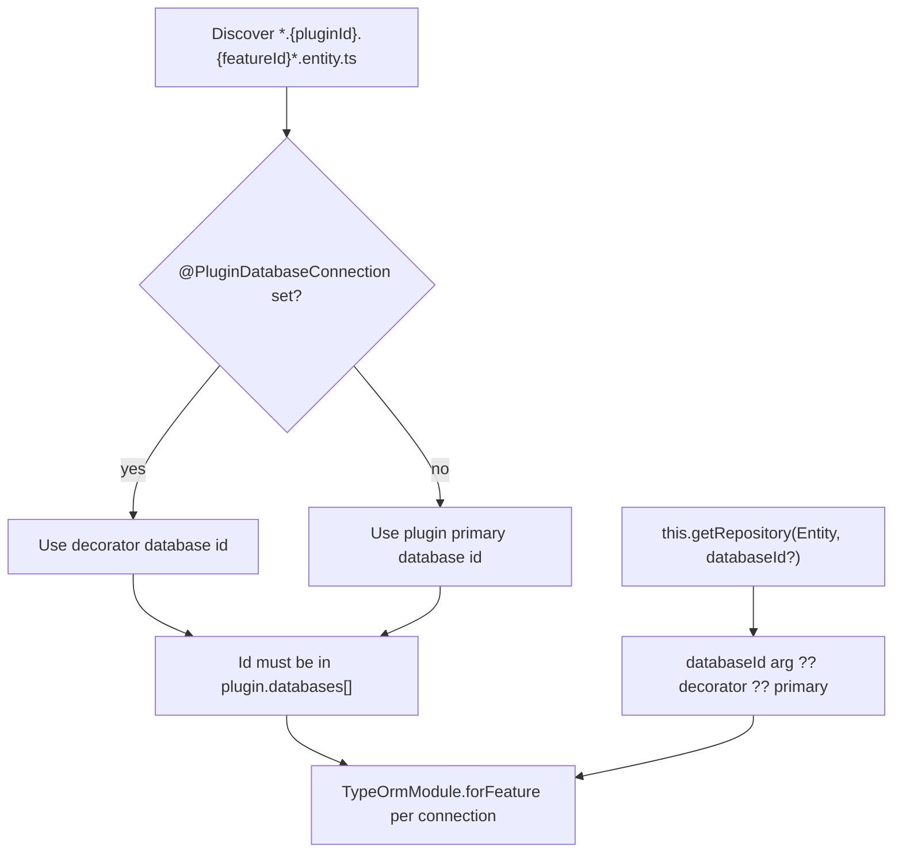

# How to assign entity classes to a database

When a plugin declares more than one database connection, each TypeORM entity class must register against one of those connections. The default is the plugin's **primary** connection. To put an entity on a different connection, annotate the class with **`@PluginDatabaseConnection`** from `@plugin/database`.

This page is the how-to. For the design behind it, see [Enhancement: Multi-Database-Per-Plugin Support](../../enhancements/multi-database-per-plugin.md). For REST/GraphQL datasource setup, see [Datasources](datasources.md).

## When you need this

| Situation | What to do |
|-----------|------------|
| Plugin has **one** `databases` entry | Do nothing. Every discovered entity registers on that connection. Do not add the decorator. |
| Plugin has **two or more** `databases` entries | Mark exactly one entry `primary: true`. Leave primary-connection entities undecorated. Decorate every entity that lives on a non-primary connection. |
| One-off query against another connection | Keep the entity on its registered connection. Pass the other id as the second argument to `getRepository` / `getDatabaseConnection`. |

The decorator is **not** a table name, schema name, or plugin id. It is the **database connection id** — the same string as `plugins[].databases[].id`, which itself references a top-level `databases[].id`.

## How assignment works

1. **Discover** — `BasePluginModule` finds entity files matching `*{pluginId}.{featureId}*.entity.ts` or `*{pluginId}.common*.entity.ts` (typically under `features/{featureId}/entities/`). Every exported `*Entity` class in those files is registered (`ClassPath.classObjs`), including when one file exports more than one entity.
2. **Resolve connection** — For each class:
   - If `@PluginDatabaseConnection('some-id')` is present, use `some-id`.
   - Otherwise use the plugin's primary connection (`primary: true`, or the first `databases` entry if none is flagged).
3. **Validate** — The resolved id must be one of that plugin's `databases` entries. An unknown id fails at boot and names the entity and the bad id.
4. **Register** — The module emits one `TypeOrmModule.forFeature(entities, connectionId)` per distinct connection referenced by the plugin's entities.
5. **Resolve at call time** — `this.getRepository(Entity)` uses: explicit `databaseId` argument → decorator on the entity → plugin primary.



## Step-by-step

### 1. Declare the physical connections

Each top-level `databases` entry is a named TypeORM connection (`TypeOrmModule.forRootAsync({ name: id })`). Connection credentials come from `.env` as `DATABASE_CONFIG_{TYPE}_{ID}` (both `TYPE` and `ID` uppercased). See [Datasources — Environment variable naming](datasources.md#environment-variable-naming-convention).

```yaml
databases:
  - id: &primary-database primary-database
    type: postgres
  - id: &reporting-database reporting-database
    type: postgres
```

### 2. Attach those connections to the plugin

`plugins[].databases[].id` must reference a top-level id (YAML anchors are the usual pattern). Flag exactly one entry `primary: true` — that is the default for undecorated entities and for `getRepository` / `getDatabaseConnection` when no id is passed.

```yaml
plugins:
  - id: &my-db my-db
    tokenId: my-db
    databases:
      - id: *primary-database
        primary: true
        consumers:
          - id: site-1
      - id: *reporting-database
        consumers:
          - id: site-1
```

A single-database plugin still uses a one-element `databases` array with `primary: true`. That is enough; skip the rest of this how-to.

### 3. Put primary-connection entities on the default (no decorator)

Place the entity where the loader can find it, and use `@Entity()` only. This class registers on `primary-database`.

```typescript
// features/user/entities/my-db.user.entity.ts
import { Column, Entity, PrimaryGeneratedColumn } from 'typeorm';

@Entity({ name: 'user', schema: 'app' })
export class MyDbUserEntity {
  @PrimaryGeneratedColumn()
  id?: number;

  @Column({ name: 'identifier', type: 'varchar', length: 255 })
  identifier?: string;
}
```

### 4. Assign a non-primary entity with `@PluginDatabaseConnection`

Import the decorator from `@plugin/database` and pass the **connection id** of the non-primary `databases` entry. Apply it on the same class as `@Entity()`.

```typescript
// features/report/entities/my-db.report.entity.ts
import { Column, Entity, PrimaryColumn } from 'typeorm';
import { PluginDatabaseConnection } from '@plugin/database';

@Entity({ name: 'usage_report', schema: 'reporting' })
@PluginDatabaseConnection('reporting-database')
export class MyDbUsageReportEntity {
  @PrimaryColumn({ type: 'varchar', length: 64 })
  id: string;

  @Column({ name: 'event_count', type: 'int' })
  eventCount?: number;
}
```

The string `'reporting-database'` must match `plugins[].databases[].id` (and therefore the top-level `databases[].id`). It is not the schema name (`reporting`) and not the table name (`usage_report`).

If the id is not in that plugin's `databases` array, boot fails with:

```text
Plugin[my-db] entity MyDbUsageReportEntity references database connection 'reporting-database',
which is not declared in this plugin's 'databases' configuration
```

### 5. Use the repository from the plugin service

`getRepository` and `getDatabaseConnection` live on **`BasePluginServiceImpl`** (every plugin service). You do not pass a connection id for the common case — the decorator (or primary) already selected it.

```typescript
import { BasePluginServiceImpl } from '@plugin/service';
import { MyDbUserEntity } from '../entities/my-db.user.entity';
import { MyDbUsageReportEntity } from '../../report/entities/my-db.report.entity';

export class MyDbUserServiceImpl extends BasePluginServiceImpl {
  async findUser(identifier: string) {
    // Undecorated entity → primary-database
    const users = this.getRepository(MyDbUserEntity);
    return users.findOne({ where: { identifier } });
  }

  async findUsageReport(id: string) {
    // Decorated entity → reporting-database (no second argument needed)
    const reports = this.getRepository(MyDbUsageReportEntity);
    return reports.findOne({ where: { id } });
  }
}
```

### 6. Override the connection for a single call (optional)

Use the second argument when the query is not tied to the entity's registered connection — for example a raw query or a `QueryRunner` on another database.

```typescript
// Force this repository lookup onto reporting-database
this.getRepository(MyDbUserEntity, 'reporting-database');

// DataSource / QueryRunner on a named connection
const reporting = this.getDatabaseConnection('reporting-database');
await reporting.query('SELECT COUNT(*) FROM reporting.usage_report');
```

Resolution order for `getRepository(entityClass, databaseId?)`:

1. `databaseId` argument, if passed
2. `@PluginDatabaseConnection` on `entityClass`, if present
3. Plugin primary (`primary: true`, or first `databases` entry)

`getDatabaseConnection(databaseId?)` uses the argument if passed, otherwise the plugin primary. It does not read the decorator (there is no entity class on that call).

## Complete example

Two connections, two entities, one service. Only the reporting entity is decorated.

```yaml
databases:
  - id: &primary-database primary-database
    type: postgres
  - id: &reporting-database reporting-database
    type: postgres

plugins:
  - id: &my-db my-db
    tokenId: my-db
    databases:
      - id: *primary-database
        primary: true
        consumers:
          - id: site-1
      - id: *reporting-database
        consumers:
          - id: site-1

features:
  - id: user
    enabled: true
    plugins:
      - id: *my-db
  - id: report
    enabled: true
    plugins:
      - id: *my-db
```

```typescript
// features/user/entities/my-db.user.entity.ts — primary (no decorator)
@Entity({ name: 'user', schema: 'app' })
export class MyDbUserEntity { /* ... */ }

// features/report/entities/my-db.report.entity.ts — non-primary
@Entity({ name: 'usage_report', schema: 'reporting' })
@PluginDatabaseConnection('reporting-database')
export class MyDbUsageReportEntity { /* ... */ }
```

```bash
# .env — one JSON blob per top-level database id
DATABASE_CONFIG_POSTGRES_PRIMARY-DATABASE={"isLoggingEnabled":true,"host":"...","port":5432,"username":"...","password":"...","database":"app","schema":"app"}
DATABASE_CONFIG_POSTGRES_REPORTING-DATABASE={"isLoggingEnabled":true,"host":"...","port":5432,"username":"...","password":"...","database":"reporting","schema":"reporting"}
```

## Checklist

- [ ] Top-level `databases` lists every physical connection the plugin will use.
- [ ] `plugins[].databases` references those ids; exactly one entry has `primary: true`.
- [ ] Entity files match `*{pluginId}.{featureId}*.entity.ts` (or `*{pluginId}.common*.entity.ts`).
- [ ] Entities on the primary connection have **no** `@PluginDatabaseConnection`.
- [ ] Entities on any other connection use `@PluginDatabaseConnection('that-connection-id')` from `@plugin/database`.
- [ ] The decorator argument equals `plugins[].databases[].id`, not a schema or table name.
- [ ] Services call `this.getRepository(Entity)` and let the decorator/primary resolve the connection, unless a one-off override is required.

## Related

- [Datasources](datasources.md) — Tying a plugin to a database; env var naming
- [Service](service.md) — `getRepository` / `getDatabaseConnection` helpers
- [Configuration](../../configuration.md) — `PluginConfiguration.databases` and `PluginDatabaseReference`
- [Enhancement: Multi-Database-Per-Plugin Support](../../enhancements/multi-database-per-plugin.md) — Design and implementation notes
