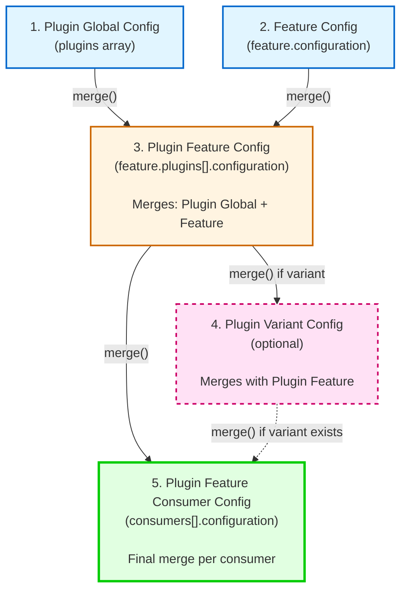

# Configuration

CatalystJS is **configuration-driven**: the main source of truth for which features, plugins, databases, middleware, and consumers are enabled—and how they are wired—is a YAML file plus environment variable overrides. At startup, the framework loads this configuration, primes and normalizes it (e.g. expanding feature trees and plugin consumer bindings), and applies environment overrides. The result is an **AppConfiguration** object used by the application and loaders.

## What configuration.yaml does

- **Declares structure** — Defines which features, plugins, databases, messengers, and middleware are present and how they are composed (e.g. which plugins a feature uses, which consumers a plugin is bound to).
- **Feature and plugin tree** — The `features` array (and nested `features` inside groups) drives which feature modules are loaded. Each feature can list `plugins`; the loader resolves plugin modules and ties them to the feature. Options like `enabled`, `standalone`, and consumer/variant configuration control what gets loaded and for which tenants or channels.
- **Datastores** — `databases` and `messengers` define database connections and message-broker clients; plugins and other code reference them by id.
- **Application behavior** — Top-level keys control API paths (e.g. `graphqlPath`, `swaggerPath`, `urlBasePath`), authorization defaults (`doAPIUserAuthorizationByDefault`, `doAPIAccessControl`), admin/setup features, CORS, logger, locales, consumers, and middleware ordering and routing.
- **Environment overrides** — After reading the YAML, the loader applies environment variable overrides so you can change values (e.g. feature toggles, API flags) without editing the file. Environment takes precedence over the YAML.

The TypeScript types for this structure (and thus the authoritative field definitions) live in **`core/foundation/configuration/types/configuration.types.ts`**. The following sections summarize the main shapes; fields whose names start with **`configured`** are internal (populated by the loader from the declarative arrays) and are omitted here.

## Where configuration.yaml is located

The file is read from the **application root directory**. The path is resolved as `{appDirectory}/configuration.yaml`, where `appDirectory` is the app’s root (e.g. the directory passed when bootstrapping the app). In typical setups this is the app folder under `src/apps/{appName}/`, so the full path is often **`src/apps/{appName}/configuration.yaml`**. Install scripts (e.g. `install-feature`, `install-plugin`, `install-database`) merge setup snippets from features/plugins/databases into this file.

## Environment variable overriding

**What it is** — Environment variable overriding lets you replace specific top-level configuration values with values from the process environment. For an overview of core environment variable names and what they do, see [Environment variables](environment-variable.md) (the canonical keys are defined in **`core/foundation/configuration/environment/environment.configuration.ts`**). You can turn flags on or off, set paths, or supply JSON (e.g. API access control) per deployment or environment without editing `configuration.yaml`. The environment value **takes precedence** over the value in the YAML file.

**How it works** — After the loader reads `configuration.yaml` and runs its priming steps (e.g. expanding features and plugin consumers), it runs **processEnvironmentOverrides**. For each configuration key that has an associated environment variable (defined in **AppConfigurationEntryConfig** in `core/foundation/configuration/app/app.configuration.ts`):

1. If that environment variable **is set** (exists in `process.env`), the loader **overwrites** the configuration value with the environment variable's value.
2. The value is then coerced by type: **boolean** keys are parsed with the framework's boolean parser (e.g. `"true"` → `true`); **json** keys are `JSON.parse`'d.
3. If the configuration key was **not** set in YAML and no environment variable was provided, a **default** from the entry config can be applied.

So: **YAML is loaded first**, then **environment variables override** only the keys that are explicitly mapped. Unmapped keys are never replaced by env vars.

**How to override a value** — Set the environment variable that is mapped to the configuration key you want to override. The mapping (config key → env var name and type) is defined in **AppConfigurationEntryConfig**. Current mappings include:

| configuration.yaml key | Environment variable | Type | Default if unset |
|------------------------|----------------------|------|------------------|
| `doAPIAccessControl` | `API_ACCESS_CONTROL_ENABLED` | boolean | `false` |
| `isSwaggerDisabled` | `DISABLE_OPENAPI_SWAGGER` | boolean | `false` |
| `isGraphqlPlaygroundDisabled` | `DISABLE_GRAPHQL_PLAYGROUND` | boolean | `false` |
| `urlBasePath` | `URL_BASE_PATH` | string | `""` |

**Example** — To disable Swagger in production without changing the YAML, set in your environment or `.env`:

```bash
DISABLE_OPENAPI_SWAGGER=true
```

To enable API access control via env:

```bash
API_ACCESS_CONTROL_ENABLED=true
```

To set the base path:

```bash
URL_BASE_PATH=/api/v1
```

**Note** — Some configuration is read directly from the environment in other places (e.g. **API_ACCESS_CONTROL** for the API access control list JSON, or **SERVICE_LOGGING** / **MAPPER_LOGGING** for logging config). Those are documented with their respective features. The table above covers only the overrides applied by **processEnvironmentOverrides** via **AppConfigurationEntryConfig**. To add or change an override, update **AppConfigurationEntryConfig** and, if needed, **EnvironmentVariableKeys** in `core/foundation/configuration/environment/environment.configuration.ts`.

## Plugin / Feature / Consumer configuration hierarchy

Configuration for plugins follows a **hierarchical merge strategy** that allows you to define configuration at multiple levels, with more specific levels overriding more general ones. This hierarchy enables plugin feature-specific overrides of global plugin configuration, and consumer-specific overrides for each plugin feature combination.

The configuration loader (see **`core/foundation/server/loader/configuration/configuration.loader.ts`**) merges configuration in the following order, with each level taking precedence over previous levels:

### Configuration hierarchy visualization

The following diagram illustrates how configurations are merged, flowing from base (most general) to most specific:



**Legend:**
- **Blue boxes** — Base configurations (levels 1-2, merged first)
- **Orange box** — Plugin feature configuration (level 3, merges both base configs)
- **Pink box (dashed)** — Plugin variant configuration (level 4, optional, merges plugin feature)
- **Green box** — Final consumer configuration (level 5, merges all previous levels, one per consumer)

**Note:** The dashed line indicates that plugin variant configuration is optional. If no variant is used, the merge flows directly from Plugin Feature Config to Consumer Config.

### Configuration hierarchy (from base to most specific)

1. **Plugin global configuration** — Defined in the top-level `plugins` array in `configuration.yaml`. This is the base configuration for a plugin across all features and consumers.

2. **Feature configuration** — Defined at the feature root level (`configuration` field in the feature definition). This configuration is merged into the plugin feature configuration, allowing feature-level settings to be inherited by plugins.

3. **Plugin feature configuration** — Defined in a feature's `plugins` array. This configuration is merged with both the plugin global configuration and the feature configuration, with plugin feature configuration taking precedence for duplicate fields. This allows you to override global plugin settings and feature settings for a specific plugin within that feature.

4. **Plugin variant configuration** (optional) — If a plugin defines variants and a consumer uses a variant, the variant's configuration is merged with the plugin feature configuration, with variant configuration taking precedence.

5. **Plugin feature consumer configuration** — Defined in the `consumers` array within a plugin (either globally or at the feature level). This is the final level and takes precedence over all previous levels. Each consumer can have different configuration values for the same plugin feature combination.

### How the merge works

The framework uses **lodash `merge()`** to combine configurations. This means:
- **Object merging** — Nested objects are merged recursively, not replaced entirely
- **Array merging** — Arrays are replaced (not merged), so the most specific level's array replaces previous arrays
- **Precedence** — Values from more specific levels override values from more general levels

### Example

Consider a plugin `my-plugin` used by feature `user` with two consumers (`site-1` and `site-2`):

```yaml
plugins:
  - id: my-plugin
    configuration:
      field1: value1
      field2: false
    consumers:
      - id: site-1
        configuration:
          pagination:
            pageSize:
              default: 20
              max: 100
          headers:
            X-Client-Version: "1.0"
      - id: site-2
        configuration:
          pagination:
            pageSize:
              default: 20
              max: 100
          headers:
            X-Client-Version: "1.0"

features:
  - id: user
    configuration:
      defaultLocale: en-US
      region: us-east
    plugins:
      - id: my-plugin
        configuration:
          field2: true  # Override global field2 setting for this feature
          field3: value3
        consumers:
          - id: site-1
            configuration:
              pagination:
                pageSize:
                  default: 50  # Override global consumer pagination
                  max: 200
              headers:
                X-Client-Version: "2.0"  # Override global consumer header
                X-Feature-Flag: enabled
              tokenId: user-token-site-1
          - id: site-2
            configuration:
              pagination:
                pageSize:
                  default: 100  # Different pagination for site-2
                  max: 500
              headers:
                X-Client-Version: "2.0"
                X-Feature-Flag: enabled
              tokenId: user-token-site-2
```

**Result for `user` feature, `my-plugin`, consumer `site-1`:**
```json
{
  "field1": "value1",                             // From plugin global
  "field2": true,                                 // From plugin feature (overrides global)
  "field3": "value3",                             // From plugin feature
  "defaultLocale": "en-US",                       // From feature configuration
  "region": "us-east",                            // From feature configuration
  "pagination": {
    "pageSize": {
      "default": 50,                              // From plugin feature consumer (overrides global consumer)
      "max": 200                                  // From plugin feature consumer (overrides global consumer)
    }
  },
  "headers": {
    "X-Client-Version": "2.0",                    // From plugin feature consumer (overrides global consumer)
    "X-Feature-Flag": "enabled"                   // From plugin feature consumer
  },
  "tokenId": "user-token-site-1"                  // From plugin feature consumer
}
```

**Result for `user` feature, `my-plugin`, consumer `site-2`:**
```json
{
  "field1": "value1",                             // From plugin global
  "field2": true,                                 // From plugin feature (overrides global)
  "field3": "value3",                             // From plugin feature
  "defaultLocale": "en-US",                       // From feature configuration
  "region": "us-east",                            // From feature configuration
  "pagination": {
    "pageSize": {
      "default": 100,                             // From plugin feature consumer (different from site-1)
      "max": 500                                  // From plugin feature consumer (different from site-1)
    }
  },
  "headers": {
    "X-Client-Version": "2.0",                    // From plugin feature consumer
    "X-Feature-Flag": "enabled"                   // From plugin feature consumer
  },
  "tokenId": "user-token-site-2"                  // From plugin feature consumer (different from site-1)
}
```

### Key points

- **Each consumer gets its own configuration** — The same plugin feature combination can have different configuration values per consumer, enabling multi-tenant scenarios where different consumers (e.g., different sites, regions, or tenants) use different settings.
- **Feature configuration is merged into plugin configuration** — Feature-level `configuration` (at the feature root) is merged into plugin feature configuration, allowing feature-wide settings to be inherited by all plugins within that feature. This enables sharing common configuration across multiple plugins in the same feature.
- **Plugin feature configuration takes precedence** — Plugin feature configuration overrides both plugin global configuration and feature configuration, allowing you to define global plugin defaults and feature defaults, then override them for specific plugins within a feature.
- **Consumer configuration is the final override** — Consumer-level configuration is merged last, allowing per-consumer customization even when plugin feature configuration is shared.

### Accessing configuration at runtime

At runtime, plugins access their consumer-specific configuration via **`PluginUtility.getPluginConsumerConfiguration()`**, which returns the fully merged configuration for the current consumer. The framework resolves the correct configuration based on:
- The current `RequestContext.consumer`
- The plugin's `id`
- The feature's `id`

This ensures that each request gets the appropriate configuration based on which consumer is making the request.

## Field definitions

The shapes below align with **`core/foundation/configuration/types/configuration.types.ts`**. Only the declarative fields you set in YAML are described; internal `configured*` fields are skipped.

### Top-level (AppConfiguration)

| Field | Type | Description |
|-------|------|-------------|
| `appName` | string | Application identifier. |
| `swaggerPath` | string | Path for Swagger/OpenAPI UI. |
| `graphqlPath` | string | Path for the GraphQL endpoint. |
| `urlBasePath` | string | Base URL path for the API. |
| `fastifyBodyLimit` | number | Optional. Maximum request body size in bytes for the Fastify adapter and for binary content-type parsers (`application/octet-stream`, images, video). Ignored when unset or not greater than `0` (Fastify default applies). |
| `doAPIUserAuthorizationByDefault` | boolean | Whether to require user authorization by default. |
| `doAPIAccessControl` | boolean | Whether API (consumer/API key) access control is enabled. |
| `isAdminAppEnabled` | boolean | Whether the admin app/API is enabled. |
| `moduleDirectories` | string[] | Directories used for module/class resolution. |
| `cors` | Record<string, any> | CORS configuration. |
| `appBootDebug` | object | Boot-time debug options: `logEntities`, `logMemory`, `logSerializedGraph`. |
| `logger` | string | Logger implementation key (e.g. `winston`). |
| `loggerMaskedFields` | string[] | Field names to mask in log output (e.g. `password`, `clientSecret`). |
| `locales` | LocalesConfiguration[] | Locale definitions (see below). |
| `consumers` | ConsumerConfiguration[] | Consumer definitions (see below). |
| `databases` | DatabaseConfiguration[] | Database connection definitions (see below). |
| `messengers` | MessengerConfiguration[] | Messenger (e.g. Kafka, Redis) client definitions (see below). |
| `plugins` | PluginConfiguration[] | Plugin definitions (can also be nested under features). |
| `features` | FeatureConfiguration[] | Feature tree; can include groups and nested `features` (see below). |
| `adminFeatures` | FeatureConfiguration[] | Admin-only feature definitions. |
| `setupFeatures` | FeatureConfiguration[] | Setup feature definitions. |
| `isSwaggerDisabled` | boolean | Disable Swagger/OpenAPI. |
| `isGraphqlPlaygroundDisabled` | boolean | Disable GraphQL Playground. |
| `defaultConsumerId` | string | Default consumer id when none is specified. |
| `defaulteLocale` | string | Default locale (note: typo in type name). |
| `consumerIds` | string[] | List of consumer ids (often derived from `consumers`). |
| `apiAccessControl` | Record<string, APIAccessControl> | API access control entries keyed by id (see below). |
| `middleware` | MiddlewareConfiguration[] | Global middleware (see below). |
| `env` | Record<string, string> | Environment key-value map (often filled from `process.env`). |

### LocalesConfiguration

| Field | Type | Description |
|-------|------|-------------|
| `id` | string | Locale id. |
| `default` | boolean | Whether this is the default locale. |

### ConsumerConfiguration

| Field | Type | Description |
|-------|------|-------------|
| `id` | string | Optional. Consumer id. |
| `configuration` | Record<string, any> | Optional. Consumer-level config. |
| `enabled` | boolean | Whether the consumer is enabled. |
| `default` | boolean | Whether this is the default consumer. |

### DatabaseConfiguration (and BaseConfiguration)

Extends **DatastoreConfiguration** (which extends **BaseConfiguration**):

| Field | Type | Description |
|-------|------|-------------|
| `id` | string | Optional. Database id. |
| `configuration` | Record<string, any> | Optional. Driver/config. |
| `type` | string | Datastore type (e.g. `postgres`). |
| `clientId` | string | Optional. Client id. |
| `enabled` | boolean | Optional. Whether enabled. |
| `defaultLogLevel` | string | Optional. Log level. |

### PluginDatabaseReference

Extends **DatabaseConfiguration**. Used for entries under a plugin's `databases` array (as opposed to the top-level `databases` array, which uses plain `DatabaseConfiguration`):

| Field | Type | Description |
|-------|------|-------------|
| `primary` | boolean | Optional. Marks this connection as the plugin's default — used to resolve entities/queries that do not specify a connection explicitly (via `@PluginDatabaseConnection` or an explicit `databaseId` argument). When no entry is marked `primary`, the first entry in the array is used. How-to: [Assigning entity classes to a database](components/plugin/assigning-entities-to-databases.md). |
| `consumers` | ConsumerConfiguration[] | Optional. Consumer bindings for this database connection. |

### MessengerConfiguration, MessengerTopicConfig

**MessengerConfiguration** extends DatastoreConfiguration:

| Field | Type | Description |
|-------|------|-------------|
| `transport` | Transport | Optional. NestJS microservice transport. |
| `topics` | MessengerTopicConfig[] | Optional. Topic configs. |

**MessengerTopicConfig** (extends BaseConfiguration):

| Field | Type | Description |
|-------|------|-------------|
| `topic` | string | Topic name. |
| `id` | string | Optional. |
| `configuration` | Record<string, any> | Optional. |

### PluginConfiguration, PluginVariantConfiguration, PluginConsumerConfiguration

**PluginConfiguration** (extends BaseConfiguration):

| Field | Type | Description |
|-------|------|-------------|
| `id` | string | Optional. Plugin id. |
| `configuration` | Record<string, any> | Optional. Plugin config. |
| `variants` | PluginVariantConfiguration[] | Optional. Variant definitions. |
| `consumers` | PluginConsumerConfiguration[] | Optional. Consumer bindings for this plugin. |
| `loggerMaskedFields` | string[] | Optional. Masked fields for plugin logging. |
| `name` | string | Optional. Display name. |
| `type` | string | Optional. Plugin type. |
| `vendor` | string | Optional. Vendor. |
| `integrationType` | string | Optional. Integration type. |
| `classNameToken` | string | Optional. Class name token. |
| `databases` | PluginDatabaseReference[] | Optional. Database connection(s) for database-backed plugins. A plugin may declare more than one; exactly one should be flagged `primary: true` as the default connection. TypeORM entities register on the connection named by their `@PluginDatabaseConnection` decorator, or the primary connection when undecorated. How-to: [Assigning entity classes to a database](components/plugin/assigning-entities-to-databases.md). |
| `configuredDatabases` | Record<string, PluginDatabaseReference> | Computed. `databases` flattened by `id` for lookup (mirrors `configuredConsumers`/`configuredVariants`). |
| `middleware` | MiddlewareConfiguration[] | Optional. Plugin-specific middleware. |

**PluginVariantConfiguration** (extends BaseConfiguration):

| Field | Type | Description |
|-------|------|-------------|
| `consumerIds` | string[] | Optional. Consumer ids for this variant. |
| `id` | string | Optional. |
| `configuration` | Record<string, any> | Optional. |

**PluginConsumerConfiguration** (extends ConsumerConfiguration):

| Field | Type | Description |
|-------|------|-------------|
| `variantId` | string | Optional. Variant id. |
| `configuration` | PluginConsumerConfigurationConfiguration | Optional. Pagination, headers, tokenId, etc. |
| `pluginDefaultConsumer` | boolean | Optional. Whether this is the plugin default consumer. |
| `enabled` | boolean | Whether enabled. |
| `default` | boolean | Whether default. |

**PluginConsumerConfigurationConfiguration**:

| Field | Type | Description |
|-------|------|-------------|
| `pagination` | PluginPaginationConfiguration | Optional. `pageSize.default`, `pageSize.max`. |
| `headers` | Record<string, string> | Optional. Headers. |
| `tokenId` | string | Optional. Token id. |

### FeatureConfiguration

| Field | Type | Description |
|-------|------|-------------|
| `id` | string | Optional. Feature id. |
| `configuration` | Record<string, any> | Optional. Feature config. |
| `group` | string | Optional. Group id. |
| `features` | FeatureConfiguration[] | Optional. Nested features (feature groups). |
| `enabled` | boolean | Optional. Whether the feature is enabled. |
| `standalone` | boolean | Optional. If true, feature has no plugins. |
| `classNameToken` | string | Optional. Class name token. |
| `plugin` | PluginConfiguration | Optional. Single plugin (legacy). |
| `plugins` | PluginConfiguration[] | Optional. Plugins for this feature. |
| `subscriptions` | SubscriptionConfiguration[] | Optional. GraphQL subscriptions config. |
| `messengers` | MessengerConfiguration[] | Optional. Messengers. |
| `middleware` | MiddlewareConfiguration[] | Optional. Feature middleware. |
| `operations` | FeatureOperationConfiguration[] | Optional. Operation-level config (e.g. ACP). |

**FeatureOperationConfiguration**:

| Field | Type | Description |
|-------|------|-------------|
| `id` | string | Operation id. |
| `description` | string | Optional. |
| `summary` | string | Optional. |
| `acp` | FeatureOperationACPConfiguration | Access control: `enabled`, `scope[]`. |

**SubscriptionConfiguration** (extends BaseConfiguration):

| Field | Type | Description |
|-------|------|-------------|
| `queries` | string[] | Query names. |
| `messenger` | MessengerConfiguration | Messenger config. |
| `topic` | MessengerTopicConfig | Topic config. |
| `id` | string | Optional. |
| `configuration` | Record<string, any> | Optional. |

### MiddlewareConfiguration

| Field | Type | Description |
|-------|------|-------------|
| `id` | string | Middleware id. |
| `enabled` | boolean | Whether enabled. |
| `sequence` | number | Order. |
| `consumers` | MiddlewareConsumerType[] | Optional. Per-consumer config. |
| `configuration` | MiddlewareConfigurationConfig | Optional. Config object. |
| `excludeRoutes` | (string \| RouteInfo)[] | Routes to exclude. |
| `forRoutes` | (string \| RouteInfo)[] | Routes to apply to. |

**MiddlewareConsumerType**:

| Field | Type | Description |
|-------|------|-------------|
| `id` | string | Consumer id. |
| `configuration` | MiddlewareConfigurationConfig | Optional. |

### APIAccessControl

| Field | Type | Description |
|-------|------|-------------|
| `apiKey` | string | API key. |
| `clientId` | string | Client id. |
| `clientSecret` | string | Client secret. |
| `scope` | string[] | Scopes. |
| `isEnabled` | boolean | Whether this entry is enabled. |

## Related

- [Architecture](architecture.md) — How ConfigurationLoader and ApplicationModuleLoader use configuration
- [Feature](components/feature/feature.md) — Features and plugins in configuration
- [Class Loading Hierarchy](class-loading-hierarchy.md) — How features and plugins are resolved from config
