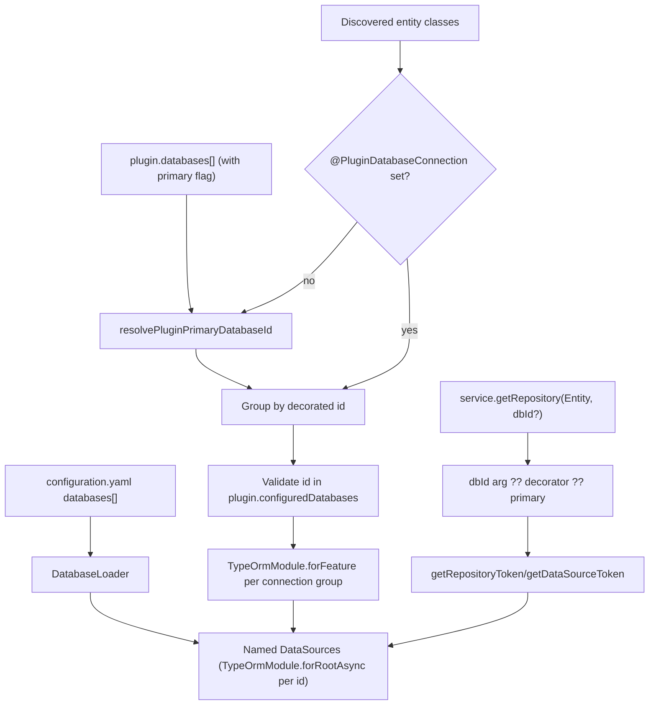

# Enhancement: Multi-Database-Per-Plugin Support

**Status:** Shipped in [1.3.113](../versions.md#v1-3-113)
**Shipped:** `59a786b` (2026-09-05), tutorial SaaS example in `a989680`
**Builds on:** [Database access for all plugins](database-access-for-all-plugins.md)

## Problem

Once database access became a capability of every plugin (not just dedicated database plugins), a plugin's database capability was still modeled as a **single** connection: one `database?: DatabaseConfiguration` field, hard-wired in three places —

- `PluginConfiguration.database` in `core/foundation/configuration/types/configuration.types.ts`
- `createPluginDatabaseImports()` in `core/foundation/plugin/module/plugin.module.ts`, which registered **every** discovered entity via a single `TypeOrmModule.forFeature(entities, pluginConfig.database.id)` call
- `getRepository()` / `getDatabaseConnection()` in `core/foundation/plugin/service/plugin.service.ts`, which always resolved against `this.plugin.configuration.database.id`

The underlying NestJS/TypeORM layer already supports multiple named connections (`TypeOrmModule.forRootAsync({ name: id })` per app-level `databases[]` entry, `forFeature(entities, connectionName)`, `getRepositoryToken(Entity, connectionName)`) — the plugin abstraction just never varied the connection name it passed in. A plugin that needed to read/write more than one physical database (e.g. a primary transactional database plus a reporting/read-replica database) had no supported way to do so.

## Design

There is no backward-compatibility requirement for this change — the singular `database` field is replaced outright by a `databases[]` array.

### 1. Configuration shape — `databases[]` with a primary flag

In `core/foundation/configuration/types/configuration.types.ts`:

- `PluginDatabaseReference extends DatabaseConfiguration` adds `primary?: boolean` and `consumers?: ConsumerConfiguration[]` (formalizing the `consumers` field already used under the old singular `database:` block).
- `PluginConfiguration.database` is replaced with:
  ```ts
  databases?: PluginDatabaseReference[];
  configuredDatabases?: { [key: string]: PluginDatabaseReference };
  ```
  (`configuredDatabases` mirrors the existing `configuredVariants`/`configuredConsumers` flattened-lookup pattern.)

In `core/foundation/server/loader/configuration/configuration.loader.ts`, `processPluginConfiguration` computes `plugin.configuredDatabases` from `plugin.databases`, and re-flattens it whenever a feature binds/merges a plugin's `databases` array.

### 2. `@PluginDatabaseConnection` decorator — per-entity connection selection

New files under `core/foundation/plugin/database/` (imported as `@plugin/database`):

- **`plugin-database-connection.decorator.ts`** — a class decorator that stores a connection id as metadata on an entity class via `reflect-metadata`:
  ```ts
  @Entity({ name: 'usage_report', schema: 'reporting' })
  @PluginDatabaseConnection('reporting-database')
  export class MyDbUsageReportEntity { ... }
  ```
  Entities without the decorator resolve to the plugin's primary connection. This keeps "which connection does this entity live on" colocated with the entity itself, with no change to the existing filename/glob-based entity discovery.

- **`plugin-database.utility.ts`** — connection resolution and validation:
  - `resolvePluginPrimaryDatabaseId(pluginConfig)` — returns the `databases[]` entry flagged `primary: true`, or the first entry if none is flagged; throws if `databases` is empty.
  - `validatePluginDatabaseConnectionId(pluginConfig, connectionId, entityName)` — throws a clear error (naming the entity and the bad id) if `connectionId` isn't one of the plugin's `configuredDatabases`.
  - `groupEntityClassesByDatabaseConnection(pluginConfig, entityClasses)` — groups discovered entity classes by `getPluginDatabaseConnection(EntityClass) ?? resolvePluginPrimaryDatabaseId(pluginConfig)`, validating each resulting connection id along the way.

### How the decorator value relates to `configuration.yaml`

The string passed to `@PluginDatabaseConnection(...)` is a database connection **id**, and it must match one of the ids in *that plugin's* `databases[]` array — not a table/schema name, not the plugin id.

- Top-level `databases[].id` in `configuration.yaml` defines the physical connection (drives `TypeOrmModule.forRootAsync({ name: id })` and the `.env` key `DATABASE_CONFIG_{TYPE}_{ID}`).
- `plugins[].databases[].id` references one of those top-level ids (via YAML anchor) — this is the set of connections a given plugin is allowed to use, with exactly one entry flagged `primary: true`.
- `@PluginDatabaseConnection('...')` on an entity must be one of the ids in that plugin's `databases[]`; `validatePluginDatabaseConnectionId` throws at boot (naming the entity and the bad id) if it references an undeclared connection.

Example, for a plugin with two connections:

```yaml
databases:
  - id: &primary-database primary-database
    type: postgres
  - id: &reporting-database reporting-database
    type: postgres

plugins:
  - id: &my-db my-db
    tokenId: my-db
    databases:
      - id: *primary-database
        primary: true
        consumers:
          - id: *site-1
      - id: *reporting-database
        consumers:
          - id: *site-1
```

```ts
@Entity({ name: 'usage_report', schema: 'reporting' })
@PluginDatabaseConnection('reporting-database') // matches plugins[].databases[].id above
export class MyDbUsageReportEntity { ... }
```

Entities without the decorator resolve to the plugin's primary connection (`primary-database` above).

### 3. Entity registration — group by connection, one `forFeature` per group

`createPluginDatabaseImports()` in `core/foundation/plugin/module/plugin.module.ts` now:

- Resolves entity classes as before (unchanged discovery via `resolveEntitiesClassPaths`).
- If entities exist but `pluginConfig.databases` is empty, throws (fail fast).
- Uses `groupEntityClassesByDatabaseConnection()` to bucket entity classes by resolved connection id.
- Emits one `TypeOrmModule.forFeature(entitiesForConnection, connectionId)` per group, instead of a single call for all entities.

### 4. Repository/connection resolution — override → decorator → primary

`getRepository()` / `getDatabaseConnection()` in `core/foundation/plugin/service/plugin.service.ts` (`BasePluginServiceImpl`):

```ts
protected getRepository<T extends Repository<any>>(
  repositoryClass: any,
  databaseId?: string,
): T {
  const resolvedDatabaseId =
    databaseId ??
    getPluginDatabaseConnection(repositoryClass) ??
    resolvePluginPrimaryDatabaseId(this.plugin.configuration);

  const token = getRepositoryToken(repositoryClass, resolvedDatabaseId);
  return this.moduleRef.get(token, { strict: false });
}

protected getDatabaseConnection(databaseId?: string): DataSource {
  const resolvedDatabaseId =
    databaseId ?? resolvePluginPrimaryDatabaseId(this.plugin.configuration);
  const token = getDataSourceToken(resolvedDatabaseId);
  return this.moduleRef.get(token, { strict: false });
}
```

This supports both selection mechanisms: **per-entity** (the decorator — the common case; existing `this.getRepository(Entity)` call sites keep working unchanged) and **per-call** (an explicit second argument, e.g. `this.getRepository(Entity, 'reporting-database')` or `this.getDatabaseConnection('reporting-database')`, for cross-connection raw queries or `QueryRunner` usage).

### 5. Flow diagram



## Configuration migration

Since backward compatibility was explicitly out of scope, every existing `database:` block was migrated to `databases: [...]` with `primary: true`:

- `src/apps/atom-appian/configuration.yaml`
- `src/apps/atom-appian/plugins/atom-appian-db/setup.configuration.yaml`
- `src/apps/catalyst-cerebrum/configuration.yaml` (3 plugin blocks: `atom-appian`, `authenticate-db`, `atom-appian-db`)
- `src/apps/catalyst-tutorial/configuration.yaml` and `src/apps/catalyst-tutorial-saas/configuration.yaml`
- `core-modules/plugins/tutorial-pet-db/setup.configuration.yaml` (template)

This migration keeps each plugin at one database entry — it doesn't add a real second physical database to any running app. Adding a genuine second connection to a specific plugin (e.g. `atom-appian-db`) is a separate follow-up now that the framework capability exists.

## Documentation updated

- [How to assign entity classes to a database](../components/plugin/assigning-entities-to-databases.md) — step-by-step how-to: YAML, `@PluginDatabaseConnection`, service lookup, validation, and a complete two-connection example
- [Datasources](../components/plugin/datasources.md) — multiple connections per plugin; links to the how-to
- [Service](../components/plugin/service.md) — `getRepository(entityClass, databaseId?)` / `getDatabaseConnection(databaseId?)` resolution order
- [Plugin — Deep dive](../components/plugin/plugin.md) — pointer to the how-to
- [Configuration](../configuration.md) (`PluginConfiguration.databases` / `PluginDatabaseReference.primary`)
- `.cursor/skills/plugins/database-plugin.md`, `.cursor/skills/plugins/SKILL.md`
- `.github/skills/plugins/database-plugin.md`, `.github/skills/plugins/SKILL.md`
- `core/agent/skills/plugins/database-plugin.md`, `core/agent/skills/plugins/SKILL.md`

## Tests

- `core/foundation/plugin/database/plugin-database-connection.decorator.spec.ts` — decorator get/set metadata.
- `core/foundation/plugin/database/plugin-database.utility.spec.ts` — `resolvePluginPrimaryDatabaseId` (no databases → throws; no primary flagged → first entry; primary flagged → that entry), `validatePluginDatabaseConnectionId`, `groupEntityClassesByDatabaseConnection` (entities split across connections produce multiple groups; undeclared decorated id throws).
- `core/foundation/plugin/service/plugin.service.spec.ts` — `BasePluginServiceImpl.getRepository`/`getDatabaseConnection` (decorator default, explicit override, primary fallback).
