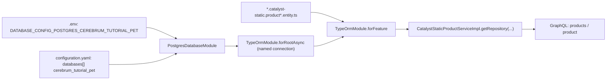

# Postgres setup and product data migration

Knowledge-transfer guide for the `catalyst-cerebrum` app. It covers how Postgres is wired in, how the `product` table was created and filled from the old static data, and how to reproduce it on a new machine or environment.

- **Audience:** developers taking over or onboarding to this repo
- **Scope:** the `catalyst-static` plugin's `product` feature (the only DB-backed feature in this app)
- **Suggested order:** section 0 (install PostgreSQL and pgAdmin), 4 (wire it in), 5 (migrate the data), 6 (verify). Sections 1 to 3 explain the design.
- **Last verified:** against a local Postgres on `localhost:5432`, database `exo_nov_training`, schema `public`

---

## 0. Install PostgreSQL and pgAdmin (Windows)

Do this once per machine. Skip to section 1 if PostgreSQL and pgAdmin are already installed and you know the `postgres` password.

### 0.1 Install

1. Download the PostgreSQL installer for Windows from <https://www.postgresql.org/download/windows/> (the EDB installer). This repo was set up with **PostgreSQL 18**. Any recent version works.
2. Run the installer as administrator and keep the default install folder (`C:\Program Files\PostgreSQL\18`).
3. On the component screen keep all four ticked:
   - **PostgreSQL Server**
   - **pgAdmin 4** (the GUI used in this guide)
   - **Stack Builder** (optional, can be unticked)
   - **Command Line Tools** (`psql`, `pg_dump`)
4. Keep the default data directory.
5. **Set a password for the `postgres` superuser and write it down.** It cannot be recovered later. You will put it in `.env` (section 4.3).
6. Keep the default port **5432**. If you change it, change `port` in `.env` too.
7. Keep the default locale and finish the wizard.

### 0.2 Verify the install

In PowerShell:

```powershell
Get-Service postgresql*                       # Status should be Running
Get-NetTCPConnection -LocalPort 5432 -State Listen
Test-Path "C:\Program Files\PostgreSQL\18\bin\psql.exe"
```

On this machine the installer summary (`C:\Program Files\PostgreSQL\18\installation_summary.log`) shows: port `5432`, superuser `postgres`, service `postgresql-x64-18`.

### 0.3 Make sure the service is running

The installer registers PostgreSQL as a Windows service that starts with Windows. If the backend or `yarn migrate:db` reports `ECONNREFUSED`, start it:

```powershell
Start-Service postgresql-x64-18               # needs an administrator PowerShell
```

You can also open **Services** (`services.msc`), find `postgresql-x64-18`, and click **Start**.

### 0.4 Connect pgAdmin to the server

1. Open **pgAdmin 4** from the Start menu. The first time, it asks you to set a **master password**. This protects pgAdmin's saved passwords and is separate from the `postgres` password.
2. In the left tree, right-click **Servers > Register > Server...** (if a server named `PostgreSQL 18` already exists, expand it and enter the `postgres` password instead).
3. **General** tab: Name = `local-postgres`.
4. **Connection** tab:

   | Field | Value |
   |---|---|
   | Host name/address | `localhost` |
   | Port | `5432` |
   | Maintenance database | `postgres` |
   | Username | `postgres` |
   | Password | the password from step 0.1.5 |
   | Save password | ticked (optional) |

5. Click **Save**. The server turns green and shows **Databases**, **Login/Group Roles**, and so on.

If you see `connection refused`, go back to section 0.3. If you see `password authentication failed`, the password is wrong.

### 0.5 Create the database

1. In pgAdmin, expand **Servers > local-postgres**, right-click **Databases > Create > Database...**.
2. Database = `exo_nov_training`, Owner = `postgres`. Click **Save**.
3. Expand **exo_nov_training > Schemas > public**. The `public` schema already exists. Tables will appear under **Tables** after the migration (section 5.4).

The SQL equivalent, run in the Query Tool of the `postgres` database, is `CREATE DATABASE exo_nov_training;`.

### 0.6 Optional: put `psql` on the PATH

`yarn migrate:db` and pgAdmin are enough for this guide, so this step is optional. To use `psql` from a terminal:

- **Current Git Bash session only:** `export PATH="$PATH:/c/Program Files/PostgreSQL/18/bin"`
- **Current PowerShell session only:** `$env:Path += ";C:\Program Files\PostgreSQL\18\bin"`
- **Permanently:** Windows search > "Edit environment variables for your account" > **Path** > **Edit** > **New** > `C:\Program Files\PostgreSQL\18\bin`, then open a new terminal.

Test with `psql --version`. To connect: `psql -h localhost -p 5432 -U postgres -d exo_nov_training` (it prompts for the password).

---

## 1. What changed and why

| Before | After |
|---|---|
| `catalyst-static` product plugin served an in-memory array (`catalyst-static.product.data.ts`) | The plugin reads the `public.product` table in Postgres through a TypeORM entity |
| No `databases` in `configuration.yaml`, no DB env var | One Postgres connection `cerebrum_tutorial_pet`, attached to the `catalyst-static` plugin |
| Static plugin was commented out for the `product` feature | Enabled for consumer `site-1` |

Request routing is unchanged: the `x-consumer` header decides the data source.

| `x-consumer` | Served by |
|---|---|
| `site-1` (default, also used when no header is sent) | `catalyst-static` plugin, now **Postgres** |
| `shopify-app` | `shopify` plugin, Shopify Storefront API |

---

## 2. How the pieces fit together



1. At startup `DatabaseLoader` reads the top-level `databases:` list in `configuration.yaml`.
2. For each entry it loads `{type}.database.module.js`. For `type: postgres` this is `core-modules/databases/postgres/postgres.database.module.ts`.
3. That module reads the connection settings from the environment variable named `DATABASE_CONFIG_{TYPE}_{ID}`, with both parts **uppercased**, and registers a named TypeORM connection.
4. The plugin module finds the entity file by name (`*{pluginId}.{featureId}*.entity.ts`) and registers it on the plugin's primary connection.
5. The service calls `this.getRepository(CatalystStaticProductEntity)`.

> **Important:** the Postgres module sets `autoLoadEntities: true` but does **not** set `synchronize`. TypeORM will never create or alter tables. The table must be created with SQL (section 5).

---

## 3. Files involved

All paths are relative to `backend/`.

| File | Purpose |
|---|---|
| `src/apps/catalyst-cerebrum/.env` | Connection settings (secret, not committed) |
| `src/apps/catalyst-cerebrum/configuration.yaml` | Declares the database, attaches it to the plugin, enables the plugin on the `product` feature |
| `src/apps/catalyst-cerebrum/plugins/catalyst-static/features/product/entities/catalyst-static.product.entity.ts` | TypeORM entity mapped to `public.product` |
| `src/apps/catalyst-cerebrum/plugins/catalyst-static/features/product/catalyst-static.product.service.ts` | `getProducts` and `getProduct`, now repository based |
| `src/apps/catalyst-cerebrum/plugins/catalyst-static/features/product/sql/catalyst-static.product.sql` | DDL and seed data (idempotent) |
| `src/apps/catalyst-cerebrum/plugins/catalyst-static/features/product/catalyst-static.product.data.ts` | Original static catalogue. Now used only for the currency constant (`USD`), and as the source the seed SQL was generated from |
| `core-modules/databases/postgres/postgres.database.module.ts` | Framework module that builds the TypeORM options |

---

## 4. One-time setup

### 4.1 Prerequisites

- Node 22 or higher (this repo was run on 24.11.0). See the main README for the Node and Yarn setup.
- PostgreSQL running and reachable. If you have not installed it yet, do section 0 first.
- The `pg` driver is already installed through the `catalystjs-postgres` workspace. No extra install is needed.

### 4.2 Create the database

Skip this if the database already exists. The easiest way is pgAdmin (section 0.5). The SQL equivalent is:

```sql
CREATE DATABASE exo_nov_training;
```

### 4.3 Add the connection settings to `.env`

File: `src/apps/catalyst-cerebrum/.env`. The value must be **one line of JSON**.

```bash
DATABASE_CONFIG_POSTGRES_CEREBRUM_TUTORIAL_PET={"isLoggingEnabled":true,"host":"localhost","port":5432,"username":"<user>","password":"<password>","database":"exo_nov_training","schema":"public"}
```

| Field | Required | Notes |
|---|---|---|
| `host`, `port`, `username`, `password`, `database` | yes | Standard Postgres connection values |
| `schema` | no | Default schema. The entity also names `public` explicitly |
| `isLoggingEnabled` | no | `true` makes TypeORM print every SQL statement. Useful in dev, turn it off elsewhere |
| `certificate` | no | Base64 client certificate. If set, TLS is enabled with `rejectUnauthorized: false` |

**Naming rule for the key:** `DATABASE_CONFIG_` + database `type` + `_` + database `id`, all uppercase. For `type: postgres` and `id: cerebrum_tutorial_pet` that gives `DATABASE_CONFIG_POSTGRES_CEREBRUM_TUTORIAL_PET`. If the key is wrong or missing, startup fails with:

```text
DATASTORE_MISSING_ENV_CONFIGURATION_DATABASE:cerebrum_tutorial_pet
```

### 4.4 `configuration.yaml`

Three edits are needed. All are already in place in this repo.

**a) Declare the connection (top level). No credentials here.**

```yaml
databases:
  - id: &db-pet cerebrum_tutorial_pet
    type: postgres
```

**b) Attach it to the plugin, marked `primary: true`.**

```yaml
plugins:
  - id: &catalyst-static catalyst-static
    name: Catalyst Static
    consumers:
      - id: *site-1
    databases:
      - id: *db-pet
        primary: true
        consumers:
          - id: *site-1
```

**c) Enable the plugin on the `product` feature.**

```yaml
features:
  - id: product
    enabled: true
    plugins:
      - id: *catalyst-static
        consumers:
          - id: *site-1
      - id: *shopify
        consumers:
          - id: *shopify-app
```

Without step (c) the plugin is never loaded and `site-1` requests return an empty result set. This was the original cause of the empty product list.

### 4.5 Entity

`entities/catalyst-static.product.entity.ts`:

```ts
@Entity({ name: 'product', schema: 'public' })
export class CatalystStaticProductEntity { /* id, identifier, slug, sku, name, description, price, listPrice, category */ }
```

The file name matters. The framework discovers entities with the pattern `*{pluginId}.{featureId}*.entity.ts`, here `*catalyst-static.product*.entity.ts`, anywhere under the plugin's `features/product/` folder. A file that does not match the pattern is silently ignored.

Because the plugin has a single database, **do not** add `@PluginDatabaseConnection`. That decorator is only needed when a plugin has more than one connection.

---

## 5. Data migration: creating and filling the table

### 5.1 The migration artefact

`plugins/catalyst-static/features/product/sql/catalyst-static.product.sql` contains both the table definition and the 18 seed rows taken from `CatalystStaticProductData.products`.

It is **idempotent**: `CREATE TABLE IF NOT EXISTS` plus `INSERT ... ON CONFLICT (identifier) DO NOTHING`. Running it twice leaves the table unchanged. It was re-run to confirm: 18 rows both times.

> **Check the `INSERT` lines before you migrate.** Lines starting with `--` are SQL comments. If the 18 `INSERT` lines are commented out, the migration creates an **empty** table and loads no data, and the product list will be empty. Remove the `--` prefix to load the seed data.
>
> Also remember that `ON CONFLICT DO NOTHING` never changes a row that already exists. Editing a value in the SQL file (for example a slug) has no effect on a database that already has that row. Use `UPDATE` for that.

### 5.2 Table definition

```sql
CREATE TABLE IF NOT EXISTS public.product (
    id          SERIAL PRIMARY KEY,
    identifier  VARCHAR(64)   NOT NULL UNIQUE,
    slug        VARCHAR(255)  NOT NULL UNIQUE,
    sku         VARCHAR(64)   NOT NULL,
    name        VARCHAR(255)  NOT NULL,
    description VARCHAR(1024),
    price       NUMERIC(12,2) NOT NULL,
    list_price  NUMERIC(12,2),
    category    VARCHAR(128)
);
```

### 5.3 Static field to column mapping

| Static record field | Column | Notes |
|---|---|---|
| `id` (`p-001`) | `identifier` | Also returned as the GraphQL `id`. A separate numeric `id` is the primary key |
| `slug` | `slug` | Unique |
| `sku` | `sku` | |
| `name` | `name` | |
| `description` | `description` | Nullable |
| `price` (string) | `price` | `NUMERIC(12,2)`. The driver returns it as a string, which matches the Money model |
| `listPrice` (optional) | `list_price` | `NULL` when the static record had no list price. The service falls back to `price` |
| `category` | `category` | Stored, not exposed by the GraphQL model |

### 5.4 Run the migration

The standard way is the `migrate:db` script. The other options are fallbacks. Run commands from `backend/`.

**Before you start:** PostgreSQL is running (section 0.3), the database `exo_nov_training` exists (section 0.5), and `DATABASE_CONFIG_POSTGRES_CEREBRUM_TUTORIAL_PET` is set in `src/apps/catalyst-cerebrum/.env` (section 4.3).

**Option A (recommended): `yarn migrate:db`.** It needs no `psql`. The script `scripts/migrate-db.js`:

1. reads the connection from `DATABASE_CONFIG_POSTGRES_<CONNECTION_ID>` (process environment first, then `src/apps/<app>/.env`),
2. finds every `*.sql` file in a `sql/` folder under `src/apps/<app>/plugins/`,
3. runs them in alphabetical path order, printing one `OK` line per file,
4. on any error prints `FAILED: <reason>` and exits with code 1.

```bash
yarn migrate:db                                   # defaults: catalyst-cerebrum cerebrum_tutorial_pet
yarn migrate:db <app> <connectionId>              # another app or connection
```

On Windows PowerShell use `yarn.cmd migrate:db`. Git Bash can use plain `yarn`.

Expected output:

```text
$ node scripts/migrate-db.js
OK  src\apps\catalyst-cerebrum\plugins\catalyst-static\features\product\sql\catalyst-static.product.sql
Done in 3.30s.
```

`OK` means the SQL ran without error. It does not report a row count, so check the data with section 5.5.

| Error | Meaning |
|---|---|
| `FAILED: DATABASE_CONFIG_POSTGRES_... not found in ...\.env` | Variable missing or misspelled (section 4.3) |
| `FAILED: password authentication failed for user "..."` | Wrong username or password in `.env` |
| `FAILED: database "exo_nov_training" does not exist` | Create it first (section 0.5) |
| `FAILED: connect ECONNREFUSED 127.0.0.1:5432` | PostgreSQL is not running (section 0.3) |
| `FAILED: Unexpected token ... in JSON` | The `.env` value is not valid one-line JSON |
| `FAILED: No sql/*.sql files found ...` | Wrong app name, or the SQL file is not inside a folder named `sql` |

The script runs **all** SQL files of the app on every call. This is safe only while every file is idempotent, so keep new SQL files idempotent. It is not a real migration tool: it keeps no history of what has run.

**Option B: `psql`**

```bash
psql -h localhost -p 5432 -U <user> -d exo_nov_training \
  -f src/apps/catalyst-cerebrum/plugins/catalyst-static/features/product/sql/catalyst-static.product.sql
```

On Windows `psql.exe` is usually not on the PATH. Call it by full path, for example `"/c/Program Files/PostgreSQL/18/bin/psql.exe"` in Git Bash.

**Option C: pgAdmin.** No command line needed (see section 0.4 to connect first).

1. In the tree, expand **Servers > local-postgres > Databases** and right-click `exo_nov_training`.
2. Choose **Query Tool**.
3. Click the **Open File** icon (folder), pick `catalyst-static.product.sql`, and click **Open**.
4. Press **F5** (or the Execute button). The Messages tab shows `Query returned successfully`.
5. Run `SELECT count(*) FROM public.product;` to confirm the row count.

DBeaver works the same way: open the SQL file against the connection and run it as a script (Alt+X).

**Option D: a throwaway Node script.** This is what `scripts/migrate-db.js` does, in its simplest form. Save it as a temporary `run-sql.js` in `backend/`, run it, then delete it.

```js
const fs = require('fs');
const { Client } = require('pg');
const l = fs.readFileSync('src/apps/catalyst-cerebrum/.env', 'utf8').split(/\r?\n/)
  .find((x) => x.startsWith('DATABASE_CONFIG_POSTGRES_CEREBRUM_TUTORIAL_PET='));
const c = JSON.parse(l.slice(l.indexOf('=') + 1));
const client = new Client({ host: c.host, port: c.port, user: c.username, password: c.password, database: c.database });
client.connect()
  .then(() => client.query(fs.readFileSync(process.argv[2], 'utf8')))
  .then(() => client.query('select count(*)::int n from public.product'))
  .then((r) => console.log('rows:', r.rows[0].n))
  .catch((e) => { console.error('FAILED:', e.message); process.exitCode = 1; })
  .finally(() => client.end());
```

```bash
node run-sql.js src/apps/catalyst-cerebrum/plugins/catalyst-static/features/product/sql/catalyst-static.product.sql
```

Expected output: `rows: 18`.

### 5.5 Verify the data

```sql
SELECT count(*) FROM public.product;                 -- 18
SELECT identifier, slug, price, list_price FROM public.product ORDER BY id LIMIT 5;
```

### 5.6 Rollback

```sql
DROP TABLE IF EXISTS public.product;
```

Dropping the table removes the data. To go back to serving the in-memory data, restore `catalyst-static.product.service.ts` from version control. The original implementation filtered `CatalystStaticProductData.products` in memory.

---

## 6. Verifying the connection and the service

### 6.1 Start the backend

```powershell
cd backend
yarn.cmd start catalyst-cerebrum
```

On Windows PowerShell use `yarn.cmd`, because script execution is restricted by default. Wait for `App URL: http://127.0.0.1:3100`. The first compile takes a few minutes and should report `Found 0 errors`.

### 6.2 Connection evidence

| Check | What to look for |
|---|---|
| Startup log | `Loading postgres database [cerebrum_tutorial_pet]: {"host":"localhost",...}` then `TypeOrmCoreModule dependencies initialized` |
| Boot failure | A wrong host, port or password stops the app at startup, so a running app means the connection works |
| Open sockets | `Get-NetTCPConnection -State Established -RemotePort 5432` shows a connection owned by the backend process |
| SQL log | With `isLoggingEnabled: true`, each product query prints `SELECT "CatalystStaticProductEntity"."id" ... FROM "public"."product"` |
| Health | `{ health { status } }` returns `UP`. This does not prove the DB is reachable, since the health feature does not query it |

### 6.3 Functional checks (GraphQL at `http://localhost:3100/graphql`)

Send header `x-consumer: site-1` (or no header).

```graphql
{ products { pagination { page pageSize pageCount resultCount hasMorePages }
             results { identifier name slug price { offer { value currency } list { value } } } } }

{ products(pagination: { pageSize: 5, page: 2 }) { pagination { pageCount hasMorePages } results { name } } }

{ products(filter: { term: "tee" }) { results { name } } }

{ product(slug: "leather-wallet") { identifier name sku price { offer { value } } } }
```

Results observed:

| Query | Result |
|---|---|
| No arguments | 18 results, `pageSize` 100, 1 page |
| `pageSize: 5, page: 2` | 5 results starting at "Merino Crew Neck", 4 pages, `hasMorePages: true` |
| `term: "tee"` | Classic Cotton Tee, Fit Guide Tee |
| `product(slug: "leather-wallet")` | `p-008`, SKU `WLT-008`, price 45.00 |
| `x-consumer: shopify-app` | Unchanged, still returns Shopify products |

### 6.4 Proof that data comes from Postgres, not the static file

Insert a row that does **not** exist in `catalyst-static.product.data.ts`, query for it, then delete it:

```sql
INSERT INTO public.product (identifier, slug, sku, name, description, price, category)
VALUES ('p-999','db-only-test-product','DBONLY-999','DB ONLY Test Product','Exists only in Postgres','1.23','Test');
-- query: { product(slug: "db-only-test-product") { identifier name } }   -> returns p-999
-- query: { products { pagination { resultCount } } }                      -> 19
DELETE FROM public.product WHERE identifier = 'p-999';
```

This test was run. The row was returned by both `product` and `products`, and the total count went from 18 to 19.

---

## 7. Making changes later

### 7.1 Add or change data

Edit the table directly, or add rows to the SQL file and re-run it. Because inserts are `ON CONFLICT DO NOTHING`, **existing rows are never updated by re-running**. To change an existing row, use `UPDATE` explicitly.

### 7.2 Change the schema (add a column)

There is no migration tool and no `synchronize`, so schema changes are manual and must stay in sync in three places:

1. Run `ALTER TABLE public.product ADD COLUMN ...;` against every environment.
2. Add the `@Column({ name: '...', type: '...' })` to `CatalystStaticProductEntity`.
3. Update `toProduct()` in the service and `catalyst-static.product.sql`, so new environments get the column.

Always give every `@Column` an explicit `type`, and a `length` for varchar. This follows the project convention and avoids relying on reflection.

### 7.3 A second database for the same plugin

Add another entry under the top-level `databases:`, add it to the plugin's `databases:` array (exactly one entry `primary: true`), define its own `DATABASE_CONFIG_POSTGRES_<ID>` variable, and put `@PluginDatabaseConnection('<connection-id>')` on entities that belong to it. The argument is the connection id, not a schema or table name. See `docs/components/plugin/assigning-entities-to-databases.md`.

### 7.4 Set up another environment

1. Create the database and a user.
2. Set `DATABASE_CONFIG_POSTGRES_CEREBRUM_TUTORIAL_PET` in that environment's `.env` (or secret store).
3. Run `yarn migrate:db` once (section 5.4).
4. Deploy and run the checks in section 6.

---

## 8. Known issues and gotchas

| Issue | Detail |
|---|---|
| `install:database` does nothing for Postgres | `core/scripts/install-database.js` looks for `setup.configuration.yaml` and `setup.env` in `core-modules/databases/postgres/`. Only `configuration.yaml` exists there, so no config or env lines are added. Edit `configuration.yaml` and `.env` by hand |
| Wrong env prefix in `.env.sample` | `.env.sample` shows `DB_CONFIG_POSTGRES_...`. The code reads `DATABASE_CONFIG_POSTGRES_...`. The `DB_` form is ignored |
| Key must be uppercase | `cerebrum_tutorial_pet` becomes `CEREBRUM_TUTORIAL_PET` in the variable name |
| Empty product list for `site-1` | The `catalyst-static` entry under `features[product].plugins` is commented out or missing (section 4.4c) |
| Entity not picked up | File name does not match `*catalyst-static.product*.entity.ts`, or it is outside the plugin's `features/product/` folder |
| `relation "product" does not exist` | The migration has not been run on that database (section 5.4) |
| `password authentication failed` or `ECONNREFUSED` | Wrong credentials in `.env`, or Postgres is not listening on that host and port. Check with `Get-NetTCPConnection -LocalPort 5432 -State Listen` |
| Default page size is 100 | With no `pagination` argument at most 100 rows are returned. The default can be changed per consumer in plugin configuration (`pagination.pageSize.default`) |
| Secrets in logs | Passwords are masked in startup logs by `loggerMaskedFields`. Keep `.env` out of version control |
| Windows PowerShell | Use `yarn.cmd` and `npm.cmd`. Plain `yarn` and `npm` are blocked by the execution policy |
| `psql: command not found` | `psql.exe` is not on the PATH after a Windows install. Use `yarn migrate:db` or pgAdmin, or call `psql.exe` by full path (section 0.6) |
| Table exists but is empty after migration | The `INSERT` lines in the SQL file are commented out with `--`. Remove the `--` and re-run `yarn migrate:db` (section 5.1) |
| `bash: user: No such file or directory` | `<user>` in a command is a placeholder. Replace it, angle brackets included, with a real name such as `postgres` |
| Changed a value in the SQL file but the database still has the old one | `ON CONFLICT DO NOTHING` skips existing rows. Run an `UPDATE` instead |
| `@nestjs/common` pinned to 12.6.0 | `backend/package.json` has a `resolutions` entry. Version 12.6.1 caused hundreds of TypeScript decorator errors. Do not remove it without re-testing the build |

---

## 9. Quick reference

```text
Connection id  : cerebrum_tutorial_pet       (configuration.yaml -> databases)
Env variable   : DATABASE_CONFIG_POSTGRES_CEREBRUM_TUTORIAL_PET
Plugin         : catalyst-static             (primary DB = cerebrum_tutorial_pet)
Table          : public.product
Entity         : CatalystStaticProductEntity
Service        : CatalystStaticProductServiceImpl (getProducts, getProduct)
Migration cmd  : yarn migrate:db             (from backend/; yarn.cmd in PowerShell)
Migration SQL  : plugins/catalyst-static/features/product/sql/catalyst-static.product.sql
Consumer header: x-consumer: site-1   -> Postgres
                 x-consumer: shopify-app -> Shopify
Backend ports  : 3100 (API), 4001 (admin)
```
